<p align="center">
  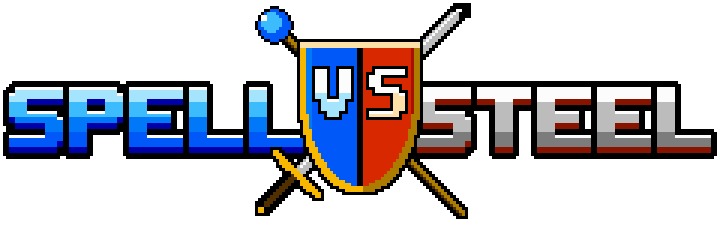
</p>

<p align="center">
  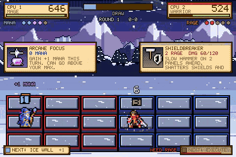
</p>

<p align="center"><i>Sword or sorcery? Settle it on the grid.</i></p>

## About this game

**Spell VS Steel** is a real-time grid battler where your deck is your weapon. Two fighters square off across a field of panels, dodging, slashing and hurling spells in a fast duel, and every few seconds the action freezes so both sides can draw fresh spells from the grimoires they built. Pick a class, master its cards, and outplay your rival one panel at a time.

Inspired by the Mega Man Battle Network series and rebuilt for fantasy heroes and head-to-head play.

### ⚔️ Five heroes, five ways to fight

<table>
  <tr>
    <td width="50%" align="center">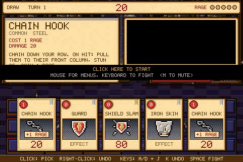<br><b>WARRIOR</b><br>Heavy armor, big hits. Every blow they take feeds their Rage, and Rage fuels brutal finishers.</td>
    <td width="50%" align="center">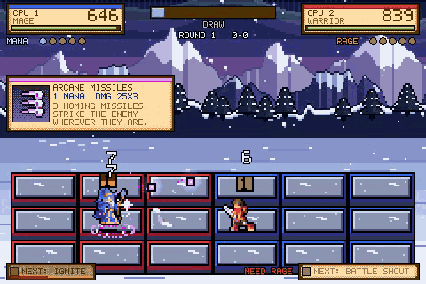<br><b>MAGE</b><br>The glass cannon. Mana grows every draw, and so do the fireballs, the freezes and the meteors.</td>
  </tr>
  <tr>
    <td width="50%" align="center">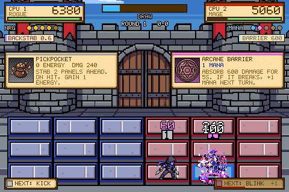<br><b>ROGUE</b><br>Chains cheap tricks, vanishes into shadow and strikes from behind with stacking poison.</td>
    <td width="50%" align="center">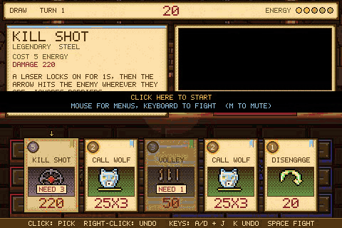<br><b>RANGER</b><br>Arrows, traps and loyal pets. Plant your feet, build Energy, then loose the perfect shot.</td>
  </tr>
  <tr>
    <td colspan="2" align="center">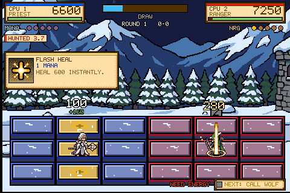<br><b>PRIEST</b><br>Outlasts everyone. Heals, holy shields and curses that burn hotter the longer you stand in them.</td>
  </tr>
</table>

Every class beats two others and struggles against two, so every matchup is a battle of wits, never a lost cause.

### 📜 Build your grimoire

Each class has its own pool of spells: commons, uncommons, a set of Legendaries and three Mythic signature cards. Shape a 30-spell grimoire around the way you like to win, or start from a ready-made deck and tweak it.

<p align="center">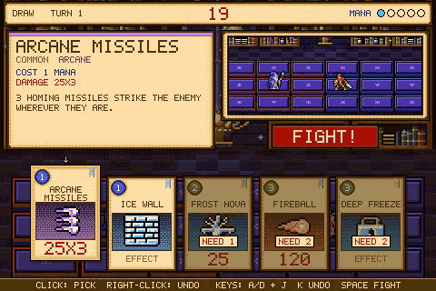</p>

### 🔥 Fight in real time

No turns, no waiting. Move across your side of the grid, dodge telegraphed attacks, and cast your spells the moment the opening appears. Freeze or stun your foe and every hit lands harder.

<p align="center">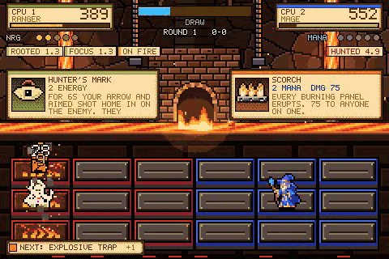</p>

### 🏆 Built for rivals

Duel a friend on the same keyboard, challenge them online with a room code, or climb the ranked ladder. Rollback netcode keeps online fights smooth, even over a shaky connection.

<p align="center">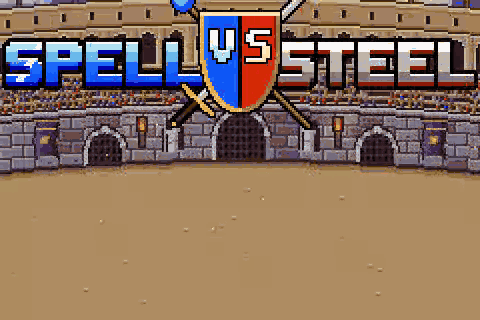</p>

## How to play

New to this kind of game? A match is one simple loop, repeated until someone falls.

**1. Pick your hero and grimoire.** Choose one of the five classes and the deck of spells you'll bring.

<p align="center">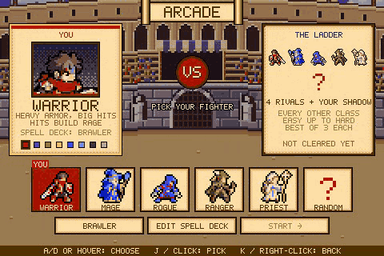</p>

**2. Fight on the grid.** The arena is 6 panels wide and 3 tall. The red half is yours, the blue half is your rival's, and neither of you can cross the line. Tap attack for a quick light hit, hold and release for a heavy one, and move between your 9 panels to line up shots and dodge theirs. Each class also has a resource bar that pays for spells: Rage, Mana or Energy.

<p align="center">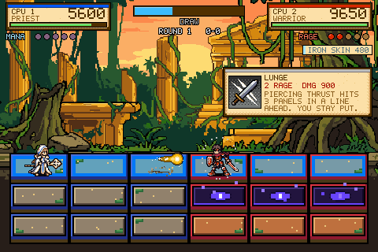</p>

**3. Draw.** The **Draw gauge** at the top fills in about 10 seconds. When it's full, open the **Draw screen**: the fight freezes and both players are dealt 5 spells. Pick the ones you can afford, in the order you want to cast them, then hit **FIGHT!**

**4. Cast.** Back in the fight, one button throws your next spell. This is where the big plays happen: fire that sets panels alight, walls of ice, traps, pets and freezes.

**5. Knock them out.** Bring your rival's HP to 0 to take the round. Win two rounds to win the match. Then it's back to the grid: fight, draw, cast, repeat.

<p align="center">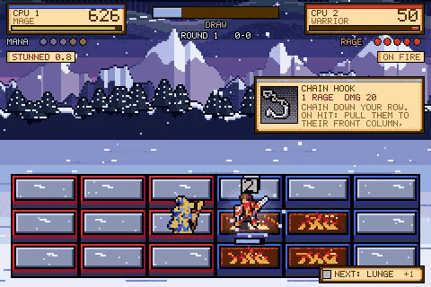</p>

Never played before? The in-game **Tutorial** walks you through all of this against a training dummy.

## Key features

- **5 playable classes**, each with its own resource, playstyle and 26-card spell pool
- **Deck building** with Legendaries, Mythics, ready-made decks, and import and export to share your builds
- **Arcade mode**: four rivals of rising difficulty, then a duel against your own Shadow Self
- **Local versus** for two players on one keyboard
- **Online play** with room codes, ranked matches and rollback netcode
- **Training mode** to test decks and practice combos, plus a step-by-step tutorial
- **Replays** and a detailed stats screen after every round
- **6 hand-drawn stages**, from a snowy mountain pass to a dwarven forge inside a volcano
- **NES-inspired pixel art** with hand-drawn animation frames and spell effects colored by element
- **Keyboard, mouse and touch** controls, all keys rebindable

## Controls

| Key | Action |
| --- | --- |
| WASD or arrows | Move |
| J (tap) | Light attack |
| J (hold, release) | Heavy attack |
| K | Cast the next spell |
| Space | Open the Draw screen when the gauge is full |
| Esc | Pause |

---

## Play it locally

You need [Node.js](https://nodejs.org/) 22 or newer.

```sh
npm install
npm run dev
```

Then open the address Vite prints (usually http://localhost:5173).

## Contributing

Thanks for wanting to help! Here's how to get going.

1. **Set up.** Fork and clone the repo, then run `npm install` and `npm run dev`. Dev builds have a **DEV TOOLS** item on the title screen with a card encyclopedia, a sandbox for testing any spell, and a balance lab that runs CPU-vs-CPU matches.
2. **Learn the layout.** [docs/ARCHITECTURE.md](docs/ARCHITECTURE.md) shows how the systems fit together, with diagrams. [docs/DEVELOPMENT.md](docs/DEVELOPMENT.md) covers every script, the dev tools, online play internals and the code map.
3. **Make your change on a branch** and open a pull request against `main`. Keep each PR to one idea.
4. **Run the checks before you push.**
   ```sh
   npm run typecheck     # the game and the tests
   npm test              # full CPU-vs-CPU matches, online determinism, saves
   npm run test:screens  # every screen at every screen shape (needs Playwright's Chromium)
   ```
   CI runs the same checks on every PR, and posts a visual diff of any screen whose pixels changed so reviewers can see what moved.

### House rules

- **The battle must stay deterministic.** Online play runs the same simulation on both machines, so anything random in the rules uses the battle's own generator (`b.rand()`), never `Math.random`. Sound and visual effects never live in the simulation: the battle emits events and the engine plays them. `npm run netcheck` and `npm run rollcheck` catch slips.
- **Spells are data.** Each spell is one entry in its class's card file under `src/game/`, and every number worth tuning is in `src/game/tuning.ts`. A new spell also needs a 20×20 card icon in `src/art/cardIcons.ts`.
- **Respect the pixel grid.** Fighters are 24×24 with hand-drawn frames. Never stretch sprites; pad them instead.
- **Saves go through the save module** (`src/engine/save.ts`), never straight to `localStorage`.
- **New screens get a screenshot test**: add them to `tests/screens/harness.ts`.
- **New classes get tutorial lessons** and show up in every character select.
- **Balance changes come with numbers.** `npm run sim` and `npm run balance` run thousands of CPU-vs-CPU matches; include the before and after win rates in your PR.

## Credits

Designed by Wes, built with Claude.
