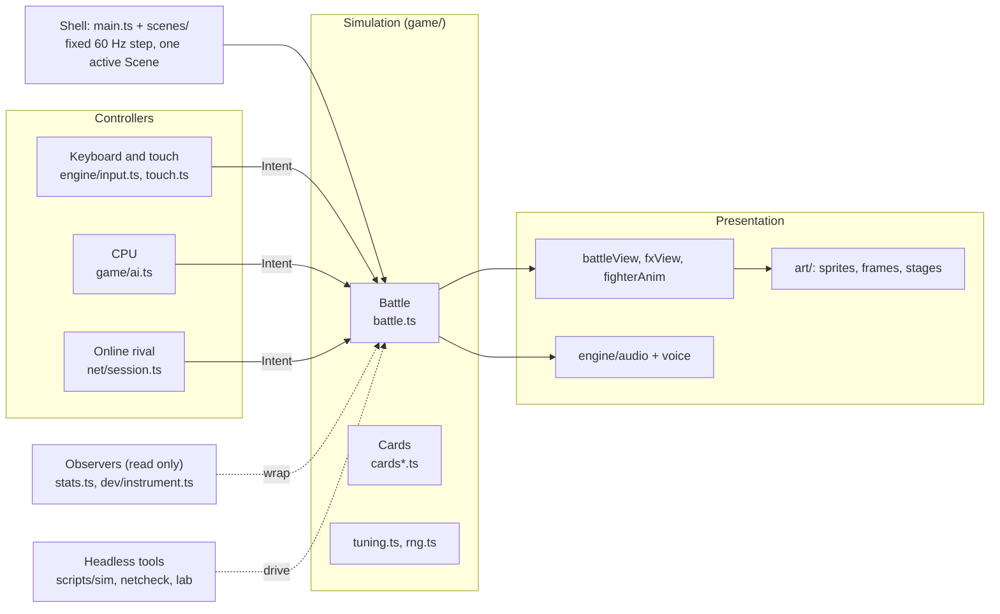
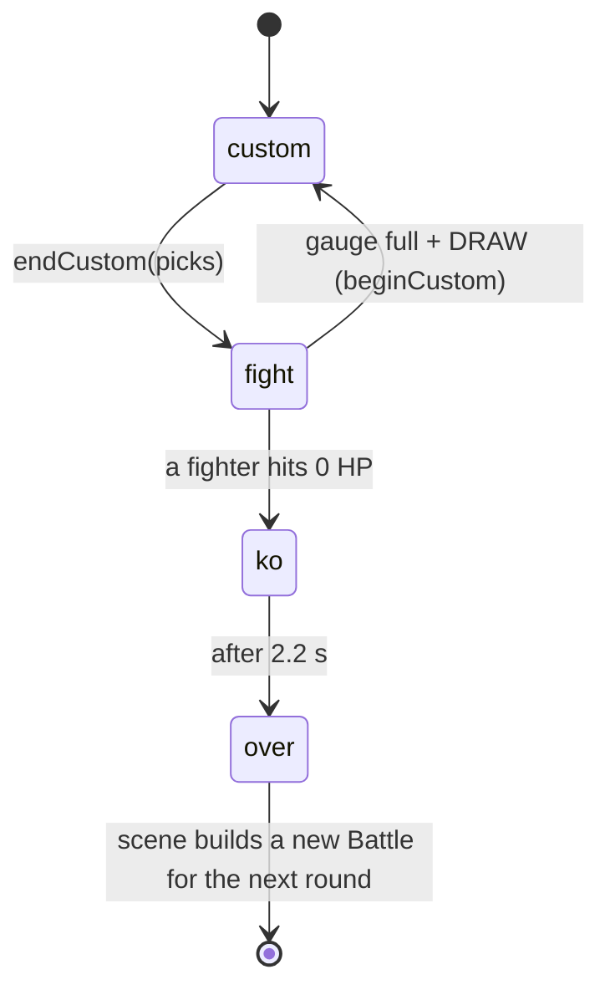
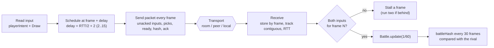
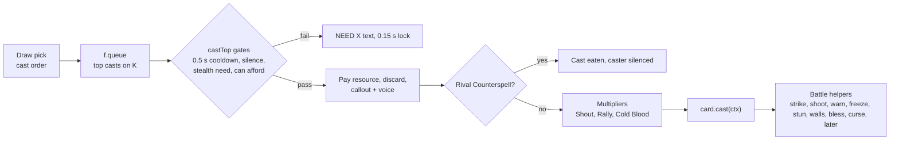
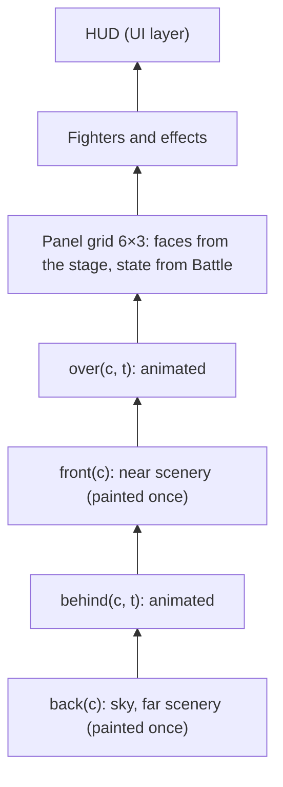
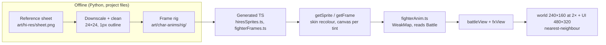
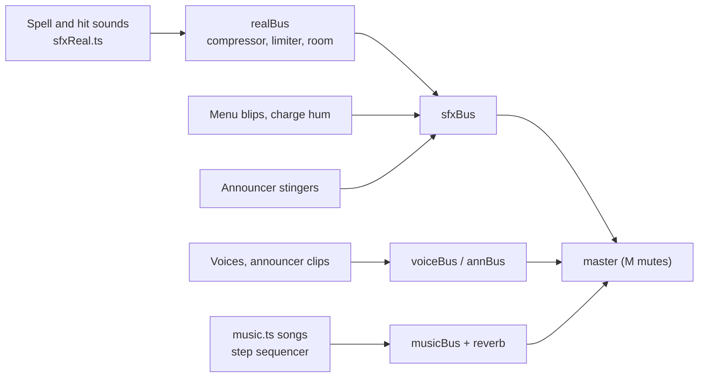
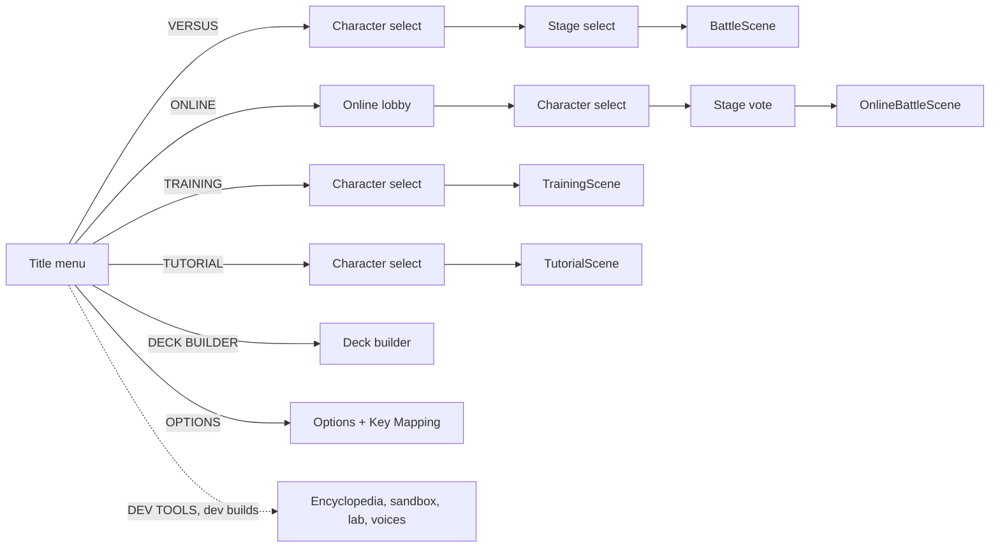
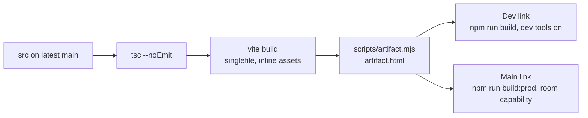

# Spell VS Steel architecture

How the game is put together, one section per system. Describes `main` at c645da5 (2026-10-26).

The full version, with a drawn diagram per system, is the living doc: https://claude.ai/artifact/TSKxaHfJ3qJXaK4SC4az2V. Keep this file and that doc in step: when a PR changes the structure described here, update the matching section in the same PR.

- [Overview](#overview)
- [Sim and game loop](#sim-and-game-loop)
- [Netcode](#netcode)
- [Characters and cards](#characters-and-cards)
- [Stages](#stages)
- [Rendering and art pipeline](#rendering-and-art-pipeline)
- [Audio](#audio)
- [UI and screens](#ui-and-screens)
- [CPU AI and styles](#cpu-ai-and-styles)
- [Balance tooling](#balance-tooling)
- [Build and publish](#build-and-publish)
- [Testing and CI](#testing-and-ci)
- [In flight](#in-flight)

## Overview

TypeScript + plain Canvas 2D, no engine, built by Vite into one self-contained HTML file. A single seeded `Battle` holds all the rules. Keyboard, CPU and online controllers all hand it the same `Intent` each frame; views, sound and observers only read it.

| Folder | What lives there |
| --- | --- |
| `src/game/` | Rules (`battle.ts`, cards per class, `ai.ts`, `tuning.ts`, `rng.ts`, decks, stats, combo) and the battle views |
| `src/scenes/` | Every screen: title, select, stage select, battle, online, training, tutorial, deck builder, options, dev tools |
| `src/art/` | Generated sprites and frames, Inked stages, logo |
| `src/engine/` | Pixel gfx, bitmap font, input, touch pad, audio, music, voice |
| `src/net/` | Lockstep session, packet protocol, transports, desync hash |
| `src/dev/` | Instrumentation, headless sims, live tuning edits (dev builds only) |
| `scripts/` | `sim`, `netcheck`, `combo-check`, artifact packer, TTS voice generator |

Platform decision (2026-10-26): stay on TypeScript; Steam through Electron, mobile through Capacitor; no consoles for now.

## Sim and game loop

`src/main.ts` runs a fixed 60 Hz accumulator on `requestAnimationFrame`: for each whole 1/60 s step it calls `scene.update(1/60)` and clears input edges, then draws once (world layer 240×160 scaled 2×, sharp UI layer 480×320 on top) and commits this frame's click zones.

The scene owns the `Battle`. Local Versus asks each side's controller for an `Intent` and calls `b.update(dt, intents)`; online only steps when both sides' inputs for that frame are in.

- `beginCustom()`: uncast picks go to the discard, class resources refill or grow, 5 spells drawn with a seeded reshuffle.
- Each fight step, in order: timers and anims, marks, warnings, panels, walls, fighters (with intents), projectiles, traps, pets, zones, then the KO check.

| Battle state | Holds |
| --- | --- |
| `f: [Fighter, Fighter]` | HP, position, resource, cooldowns, deck / queue / discard, statuses `st`, shields, DoTs, pose |
| `panels[6][3]` | Owner (grid steal), cracked / hole, burn, toxic, bless, curse, smoke |
| `walls`, `projectiles`, `traps`, `pets`, `warns` | Spawned objects; warnings flash panels 0.5 s before area hits |
| `timers`, `anims` | Closures from `later(delay, fn)` and `anim(dur, fn)` |
| `rand` | Seeded mulberry32; every rule roll goes through it |
| `fx`, `texts`, `shake`, `combo` | Display-only state for the views |

Determinism rules:

- Rule randomness comes from `b.rand()` or `shuffle(list, b.rand)`, never `Math.random`. `npm run netcheck` catches drift.
- Observers wrap methods on one instance and only read state.
- The CPU and voice-line choice use `Math.random`; neither feeds the rules online, but rollback will need them seeded or kept out of resimulation.
- Rollback blocker: `timers` and `anims` hold closures (about 30 call sites in `battle.ts` and the card files), so a Battle can't be snapshotted yet.

## Netcode

Delay-based lockstep: both machines run the same seeded Battle and only trade controls.

| File | Job |
| --- | --- |
| `net/session.ts` | `NetSession`: handshake, readiness, input buffers, RTT, delay, desync flag |
| `net/protocol.ts` | `Packet`, `PROTOCOL = 3`, 10-bit input packing (2 chars per frame), room codes |
| `net/transport.ts` | `room` (claude.ai artifact presence), `peer` (WebRTC via PeerJS), `local` (BroadcastChannel, fake lag) |
| `net/hash.ts` | `battleHash(b)`, FNV-1a over everything the rules read |
| `scenes/online.ts`, `scenes/onlineBattle.ts` | Lobby and the lockstep-driven Versus scene |

- Every packet is the sender's whole current state, never a one-off event, so drops and merges lose nothing (this is what lets it ride on room presence, which keeps only the latest value).
- Draw picks travel in `packet.picks`; there is no pause online. Each round reseeds as `seed + r × 0x9e3779b9`.
- Bump `PROTOCOL` whenever rules or packets change. 6 s of silence ends the match.
- Rollback (in progress): predict the rival's input, snapshot every frame, rewind and replay on a late input.

## Characters and cards

`CardDef` (`game/cards.ts`): `id, name, cls, cost (0..5 | 'all'), rarity, element, damaging, lock, dmg, short, gain, needsStealth, cast(ctx), ai(b, f)`.

| Class | HP | Light / heavy | Resource | Comes back | Cards |
| --- | --- | --- | --- | --- | --- |
| Warrior | 870 | 7 / 32 | Rage, max 5 | Heavy hits +1.5, taking damage 1 per 40 (max 1 per hit) | `cards.ts` |
| Mage | 690 | 6 / 28 | Mana | Max 1, +1 per Draw (cap 5), refills each Draw | `cards.ts` |
| Rogue | 650 | 12 / 22 | Energy | Topped up to 5 each Draw | `cardsRogue.ts` |
| Ranger | 740 | 8 / 20 | Energy | Starts 2, +1 per Draw, grows standing still | `cardsRanger.ts` |
| Priest | 700 | 6 / 28 | Mana | Starts 3, +3 per Draw (cap 5) | `cardsPriest.ts` |

`tuning.ts` is the source of truth for numbers. Each class has 26 cards, a starter deck and 3 Mythic decks (`game/deck.ts`). Deck rules: exactly 30, 4 / 2 / 1 copies by rarity, max 5 Legendaries, exactly 1 Mythic. Custom decks save per class (`svs:deck:<class>`); `game/grimoireYaml.ts` imports and exports YAML.

Adding a class today touches: `art/sprites.ts` (+ generated sprites and frames), `game/classes.ts`, a `tuning.ts` block, a `cardsX.ts` merged into `CARDS`, resource rules in `battle.ts`, decks in `deck.ts`, `game/fighterAnim.ts`, voice lines, and tutorial lessons (every new character gets tutorial support). The modularize pass will gather these into `src/content/classes/<id>/`.

## Stages

Stages are scenery only: same 6×3 grid, same red / blue rims, same rules.

| Id | Name | File |
| --- | --- | --- |
| `colosseum` | Grand Colosseum | `art/arena.ts` |
| `courtyard` | Castle Courtyard | `art/stages.ts` |
| `archive` | Arcane Archive | `art/stages.ts` |
| `frostpeak` | Frostpeak Pass | `art/stages.ts` |
| `emberforge` | Emberforge | `art/stages.ts` |
| `elderwood` | Elderwood Ruins | `art/stages.ts` |

`StageDef` = id, name, tag, `PanelLook`, panel `tex()`, up to four layer painters. `getStage(id)` builds and caches; `STAGE_IDS` feeds stage select. `art/ink.ts` is the Inked toolkit. Online, both players vote; a tie wins, otherwise a seeded coin flip.

## Rendering and art pipeline

- Fighters stay 24×24 and are never stretched in menus; spell effects keep a 24×24 footprint and take their element's colour.
- Visual state never goes into the Battle, so lockstep and the hash never see it.
- The canvas fits the window between 4:3 and 21:9 (shows more stage, no letterbox); phones in portrait give the bottom half to the touch pad.
- UI skin: Parchment (`scenes/skin.ts`). Cards: `scenes/cardView.ts`. Font: `engine/font.ts` (5×7).

## Audio

All effects and music are synthesized live in WebAudio; only voice clips are recorded (TTS, base64 MP3 in `engine/voiceClips.ts`, generated by `scripts/voices/gen.py`).

The Battle calls `sfx()`, `sfxFx()` and `voiceLine()` directly; sounds never feed back into rules. `withoutSfx()` silences previews and sims. Volumes save in `svs:audio`, mute in `svs:muted`.

## UI and screens

One `Scene` at a time (`scenes/scene.ts`: `update`, `draw(world, tick, ui)`, `enter?`, `pad?`). Switch with `setScene(new X())`; there is no stack.

- `OnlineBattleScene` and `TrainingScene` extend `BattleScene`; `TutorialScene` drives one. Card previews run their own tiny muted Battle.
- Menus are mouse-first: scenes register click zones while drawing (`zone(...)`), the next update reads `hotZone()`. Combat is keyboard or the touch pad (`engine/touch.ts`).
- Saved in the browser: `svs:match`, `svs:deck:<class>`, key bindings, `svs:audio`, `svs:muted`, `svs:training`, `svs:tutorial`.

## CPU AI and styles

`Cpu.intent(b, f, dt)` (`game/ai.ts`) returns the same `Intent` a keyboard player would. When its think timer runs out it re-decides, in priority order: 1. dodge warned panels and shots, 2. cast the top spell when `card.ai()` agrees or it has waited long enough, 3. basic attacks (hold heavy when it will reach), 4. position (track the row, plus class habits).

| Level | Think | Aim | Dodge | Cast patience |
| --- | --- | --- | --- | --- |
| Easy | 0.6 s | 0.55 | 0 | 3 s |
| Normal | 0.22 s | 0.9 | 0.85 | 1.5 s |

PR #29 adds per-class styles (aggro, conservative, defensive), a Hard level that counter-picks, and ties difficulty to styles.

## Balance tooling

`dev/simulate.ts`: `runMatch` plays a real Battle with two `Cpu`s at 60 Hz (600 s cap = draw); `dev/instrument.ts` tags every hit with its spell. `runSeries` aggregates wins with a Wilson 95% range, time, turns, damage split and per-card stats.

| Tool | Run | Gives |
| --- | --- | --- |
| Sim CLI | `npm run sim -- 100 --cards` | All class pairs with starters, per-card table |
| Balance lab | dev build, `#lab` | The same in the browser, class matrix, live `TUNING` and card % edits |
| Sandbox | `#sandbox` | Cast anything, dummies, can't-die, slow time, frame step, hit log |
| Encyclopedia | `#cards` | Every card face with filters |

PR #29 adds `npm run balance` (worker-thread grid, ~750 matches/s), a script box, deck pools and CPU styles. Reports: project files `balance/2026-10-26/`.

## Build and publish

| Link | Build |
| --- | --- |
| Main (prod): https://claude.ai/artifact/1kBiHGD35b15oWBEWxcAcr | `npm run build:prod` → `dist-prod/artifact.html` |
| Dev: https://claude.ai/artifact/8xAkx41kQdJWmNQKZpBVJU | `npm run build` → `dist/artifact.html` |

Release: PR → Wes says "lgtm" → merge → rebuild from latest main → publish the main link and the dev link from the same commit. `DEV_TOOLS` (`src/flags.ts`) gates dev-only code; the dev menu is a dynamic import so prod ships none of it.

## Testing and CI

No test framework and no CI yet (no `.github/workflows`).

| Command | Run it when | Fails on |
| --- | --- | --- |
| `npm run typecheck` | Every change | Type errors, unused locals |
| `npm run netcheck` | Rules or card changes | Two seeded battles with the same inputs drifting apart |
| `npm run sim` | Rules, card or CPU changes | Crashes, stuck matches, surprising win rates |
| `npm run combocheck` | Status or hitstun changes | Combo counter counting escapable hits |
| `npm run build:prod` | Before publishing | All of the above plus a broken bundle |

`window.__svs.getScene()` is exposed for automated playtests.

## In flight

- Modularize for modding: PR #35 adds `src/content/registry.ts` (`Registry<T>`) and moves stages to `src/content/stages/`, plus `npm run golden`; class folders follow.
- Rollback netcode: Battle state as plain data (timers and anims as records), then prediction with rewind and replay.
- PR #29 balance tooling and CPU styles, #32 BN indicators, #34 hit feel, #36 panel effects, regression tests, fuzz and perf, arcade ladder, replays, soundtrack.
