# Spell VS Steel architecture

How the game is put together, one section per system. Describes `main` at fdafc4e (2026-10-26).

The full version, with a drawn diagram per system, is the living doc: https://claude.ai/artifact/TSKxaHfJ3qJXaK4SC4az2V. Keep this file and that doc in step: when a PR changes the structure described here, update the matching section in the same PR.

- [Overview](#overview)
- [Sim and game loop](#sim-and-game-loop)
- [Netcode](#netcode)
- [Characters and cards](#characters-and-cards)
- [Stages](#stages)
- [Rendering and art pipeline](#rendering-and-art-pipeline)
- [Audio](#audio)
- [UI and screens](#ui-and-screens)
- [Input and platform](#input-and-platform)
- [CPU AI and styles](#cpu-ai-and-styles)
- [Balance tooling](#balance-tooling)
- [Build and publish](#build-and-publish)
- [Testing and CI](#testing-and-ci)
- [In flight](#in-flight)

## Overview

TypeScript + plain Canvas 2D, no engine, built by Vite into one self-contained HTML file. A single seeded `Battle` holds all the rules. Keyboard, CPU and online controllers all hand it the same `Intent` each frame; views, sound and observers only read it.

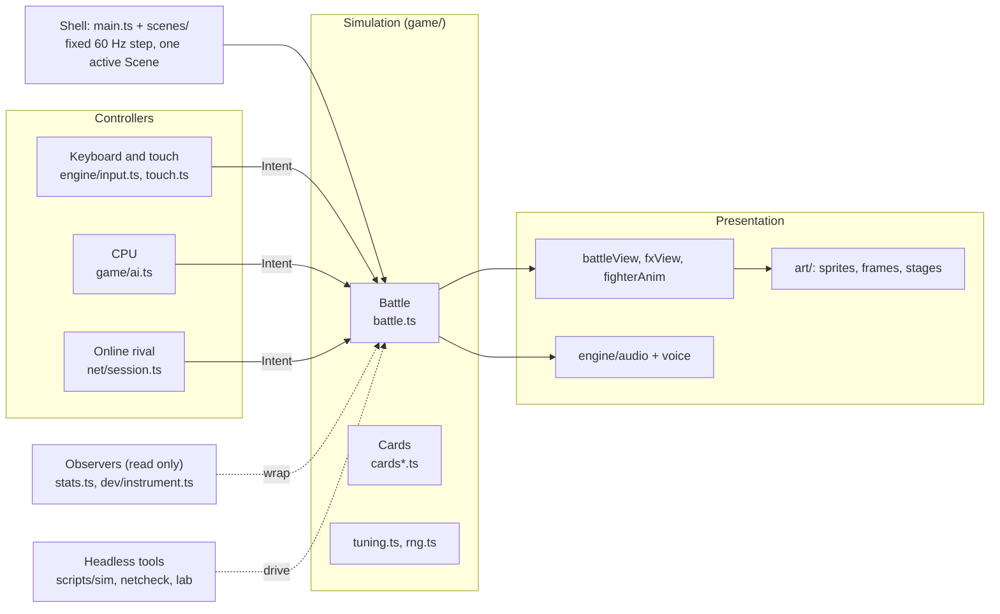

| Folder | What lives there |
| --- | --- |
| `src/game/` | Rules (`battle.ts`, cards per class, `ai.ts`, `tuning.ts`, `rng.ts`, decks, stats, combo) and the battle views |
| `src/scenes/` | Every screen: title, select, stage select, battle, online, training, tutorial, deck builder, options, dev tools |
| `src/art/` | Generated sprites and frames, Inked stages, logo |
| `src/engine/` | Pixel gfx, bitmap font, input, touch pad, audio, music, voice |
| `src/net/` | Rollback netplay, snapshots, session, packet protocol, transports, desync hash |
| `src/dev/` | Instrumentation, headless sims, live tuning edits (dev builds only) |
| `scripts/` | `sim`, `netcheck`, `combo-check`, artifact packer, TTS voice generator |

Platform decision (2026-10-26): stay on TypeScript; Steam through Electron, mobile through Capacitor; no consoles for now.

## Sim and game loop

`src/main.ts` runs a fixed 60 Hz accumulator on `requestAnimationFrame`: for each whole 1/60 s step it calls `scene.update(1/60)` and clears input edges, then draws once (world layer 240×160 scaled 2×, sharp UI layer 480×320 on top) and commits this frame's click zones.

The scene owns the `Battle`. Local Versus asks each side's controller for an `Intent` and calls `b.update(dt, intents)`; online only steps when both sides' inputs for that frame are in.

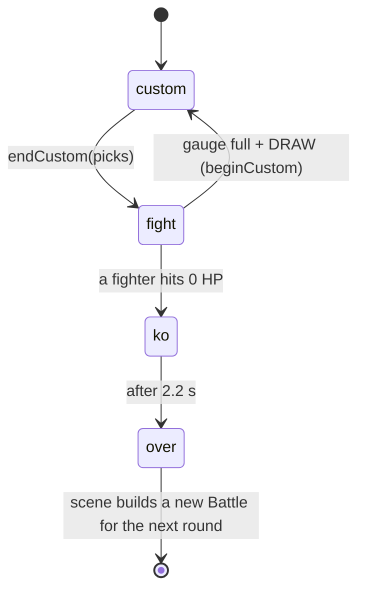

- `beginCustom()`: uncast picks go to the discard, class resources refill or grow, 5 spells drawn with a seeded reshuffle.
- Each fight step, in order: timers and anims, marks, warnings, panels, walls, fighters (with intents), projectiles, traps, pets, zones, then the KO check.

| Battle state | Holds |
| --- | --- |
| `f: [Fighter, Fighter]` | HP, position, resource, cooldowns, deck / queue / discard, statuses `st`, shields, DoTs, pose |
| `panels[6][3]` | Owner (grid steal), cracked / hole, burn, toxic, bless, curse, smoke |
| `walls`, `projectiles`, `traps`, `pets`, `warns` | Spawned objects; warnings flash panels 0.5 s before area hits |
| `timers`, `anims` | Closures from `later(delay, fn)` and `anim(dur, fn)` |
| `rand` | Seeded mulberry32; every rule roll goes through it |
| `fx`, `texts`, `shake`, `combo` | Display-only state for the views |

Determinism rules:

- Rule randomness comes from `b.rand()` or `shuffle(list, b.rand)`, never `Math.random`. `npm run netcheck` catches drift.
- Observers wrap methods on one instance and only read state.
- Each CPU rolls from `substream(b.seed, side)` (`game/rng.ts`), a stream separate from `b.rand`, so a CPU match replays exactly from its seed. Card `ai` hints get that `rand`. `tests/matches.ts` gives `Math.random` a new stream on every play, so a leak fails its replay check. Voice-line choice still uses `Math.random` (sound only).
- Double K.O.: if both fighters hit 0 HP on the same frame, the round is a draw (`winner` stays null, nobody scores, the set plays another round).
- `timers` and `anims` still hold closures. Rollback works anyway because `net/snapshot.ts` restores the Battle in place, so the closures keep pointing at live objects. Delayed effects must keep their mutable state in `b.keep({...})`, and the RNG state is saved with `rand.setState`.
- Replays (`game/replay.ts`): a match is a list of round tapes (seed, decks, per-frame inputs) plus a rules fingerprint, so playback just reruns the Battle. `npm run replaycheck` checks a replay ends with the same hash.

## Netcode

Rollback (GGPO style, #44): both machines run the same seeded Battle and only trade controls. The rival's missing input is guessed; a wrong guess is fixed by rewinding to the last confirmed frame and replaying.

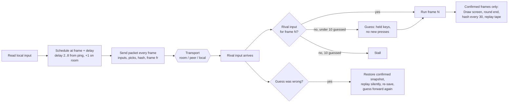

| File | Job |
| --- | --- |
| `net/netplay.ts` | `Netplay`: drives one online round for the scene and `netsoak`; input delay, pacing against the rival's frame `fr` (runs 2 frames when behind, skips a tick when ahead) |
| `net/rollback.ts` | `Rollback`: one confirmed snapshot, guesses up to `MAX_ROLLBACK = 10` frames, rewind and replay, `onConfirmed` feeds the replay `TapeWriter` |
| `net/snapshot.ts` | Snapshots the Battle object graph and restores it in place; watchers (post-match stats) pass extra roots |
| `net/session.ts` | `NetSession`: handshake, readiness, input buffers, RTT, status (waiting / connected / reconnecting / lost), desync flag |
| `net/protocol.ts` | `Packet`, `PROTOCOL = 5`, 10-bit input packing (2 chars per frame), room codes |
| `net/transport.ts` | `room` (claude.ai artifact presence), `peer` (WebRTC via PeerJS), `local` (BroadcastChannel, fake lag) |
| `net/hash.ts` | `battleHash(b)`, FNV-1a over everything the rules read |
| `scenes/online.ts`, `scenes/onlineBattle.ts` | Online menu and the Versus scene driven by `Netplay` |

- Every packet is the sender's whole current state, never a one-off event, so drops and merges lose nothing (this is what lets it ride on room presence, which keeps only the latest value).
- Draw picks travel in `packet.picks`; there is no pause online. Each round reseeds as `seed + r × 0x9e3779b9`.
- Bump `PROTOCOL` whenever rules or packets change.
- Silence: after 1.5 s the screen says RECONNECTING and holds; after 30 s the match counts as dropped. A backgrounded tab sends `away` and only pings, so the rival waits longer instead of timing out.
- `npm run netsoak` plays whole headless online matches over a fake bad network (lag, jitter, loss, duplicates, outages, latest-value-only delivery, hitches, background tabs) and compares every checksum.
- `npm run rollcheck` (in CI) proves rollback play ends exactly like straight play.
- Next: a `BattleEvent` sink so the sim emits hit / cast / KO / sound events and `engine/battleAudio.ts` plays them.

### Online services

Everything online rides on the artifact's `room` presence plus a small `db` for ratings; there is no game server.

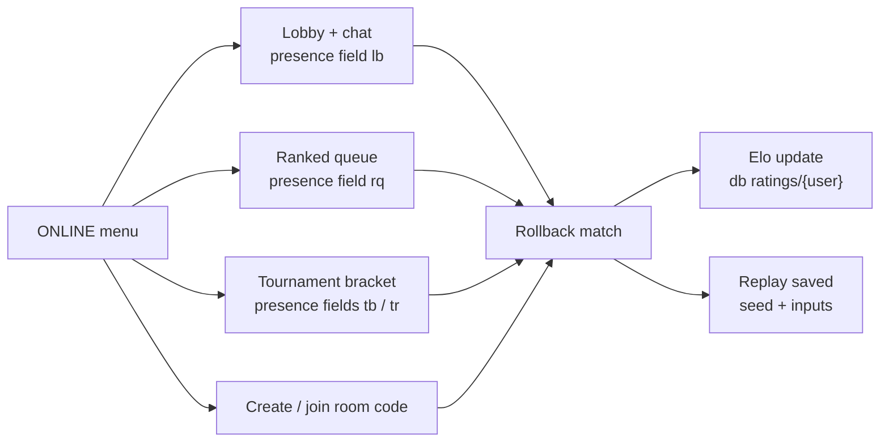

| File | Job |
| --- | --- |
| `scenes/lobby.ts` | Who's online, chat, challenges |
| `scenes/ranked.ts` | Queue, pairing, Elo in the artifact db (`ratings`), pending result recovery |
| `scenes/tournament.ts` | Bracket host and players over presence |
| `scenes/replays.ts` | Replay list and playback |

- Both links must publish with the `room`, `db` (ratings rules) and `user` (profile) capabilities, or ranked breaks.
- `npm run rankedcheck` exercises the ranked flow by hand.

## Characters and cards

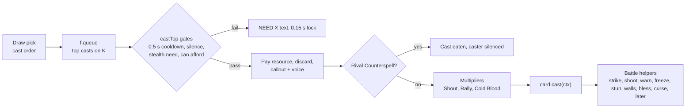

`CardDef` (`game/cards.ts`): `id, name, cls, cost (0..5 | 'all'), rarity, element, damaging, lock, dmg, short, gain, needsStealth, cast(ctx), ai(b, f)`.

| Class | HP | Light / heavy | Resource | Comes back | Cards |
| --- | --- | --- | --- | --- | --- |
| Warrior | 870 | 7 / 32 | Rage, max 5 | Heavy hits +1.5, taking damage 1 per 40 (max 1 per hit) | `cards.ts` |
| Mage | 690 | 6 / 28 | Mana | Max 1, +1 per Draw (cap 5), refills each Draw | `cards.ts` |
| Rogue | 650 | 12 / 22 | Energy | Topped up to 5 each Draw | `cardsRogue.ts` |
| Ranger | 740 | 8 / 20 | Energy | Starts 2, +1 per Draw, grows standing still | `cardsRanger.ts` |
| Priest | 700 | 6 / 28 | Mana | Starts 3, +3 per Draw (cap 5) | `cardsPriest.ts` |

`tuning.ts` is the source of truth for numbers. Each class has 26 cards, a starter deck and 3 Mythic decks (`game/deck.ts`). Deck rules: exactly 30, 4 / 2 / 1 copies by rarity, max 5 Legendaries, exactly 1 Mythic. Custom decks save per class in `save.json`; `game/deckYaml.ts` imports and exports YAML.

Adding a class today touches: `art/sprites.ts` (+ generated sprites and frames), `game/classes.ts`, a `tuning.ts` block, a `cardsX.ts` merged into `CARDS`, resource rules in `battle.ts`, decks in `deck.ts`, `game/fighterAnim.ts`, voice lines, and tutorial lessons (every new character gets tutorial support). The modularize pass will gather these into `src/content/classes/<id>/`.

## Stages

Stages are scenery only: same 6×3 grid, same red / blue rims, same rules.

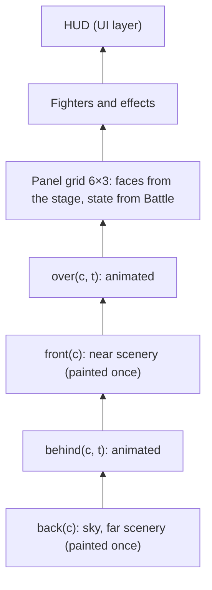

| Id | Name | File |
| --- | --- | --- |
| `colosseum` | Grand Colosseum | `art/arena.ts` |
| `courtyard` | Castle Courtyard | `art/stages.ts` |
| `archive` | Arcane Archive | `art/stages.ts` |
| `frostpeak` | Frostpeak Pass | `art/stages.ts` |
| `emberforge` | Emberforge | `art/stages.ts` |
| `elderwood` | Elderwood Ruins | `art/stages.ts` |

`StageDef` = id, name, tag, `PanelLook`, panel `tex()`, up to four layer painters. `getStage(id)` builds and caches; `STAGE_IDS` feeds stage select. `art/ink.ts` is the Inked toolkit. Online, both players vote; a tie wins, otherwise a seeded coin flip.

## Rendering and art pipeline

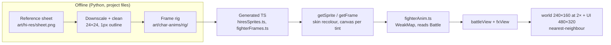

- Fighters stay 24×24 and are never stretched in menus; spell effects keep a 24×24 footprint and take their element's colour.
- Visual state never goes into the Battle, so rollback and the hash never see it.
- The canvas fits the window between 4:3 and 21:9 (shows more stage, no letterbox); phones in portrait give the bottom half to the touch pad.
- UI skin: Parchment (`scenes/skin.ts`). Cards: `scenes/cardView.ts`. Font: `engine/font.ts` (5×7).

## Audio

All effects and music are synthesized live in WebAudio; only voice clips are recorded (TTS, base64 MP3 in `engine/voiceClips.ts`, generated by `scripts/voices/gen.py`).

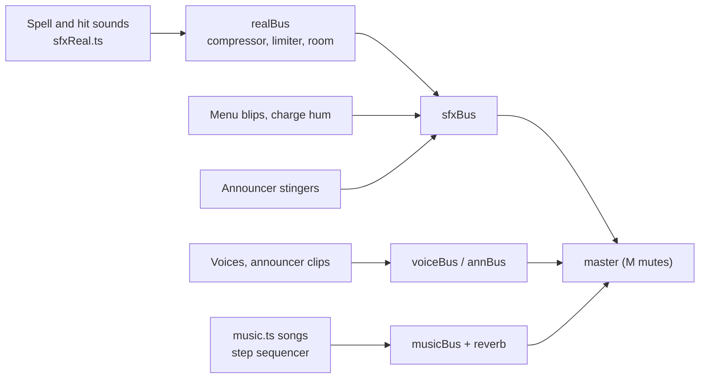

The Battle calls `sfx()`, `sfxFx()` and `voiceLine()` directly; sounds never feed back into rules. `withoutSfx()` silences previews and sims. Volume and mute live in `save.json`.

## UI and screens

Screens live on a stack (`scenes/stack.ts`, re-exported by `scenes/scene.ts`). A `Scene` has `update`, `draw(world, tick, ui)`, `enter?` (first open), `resume?` (shown again after the screen on top closes), `pad?` and `suspend?` (the game went to the background).

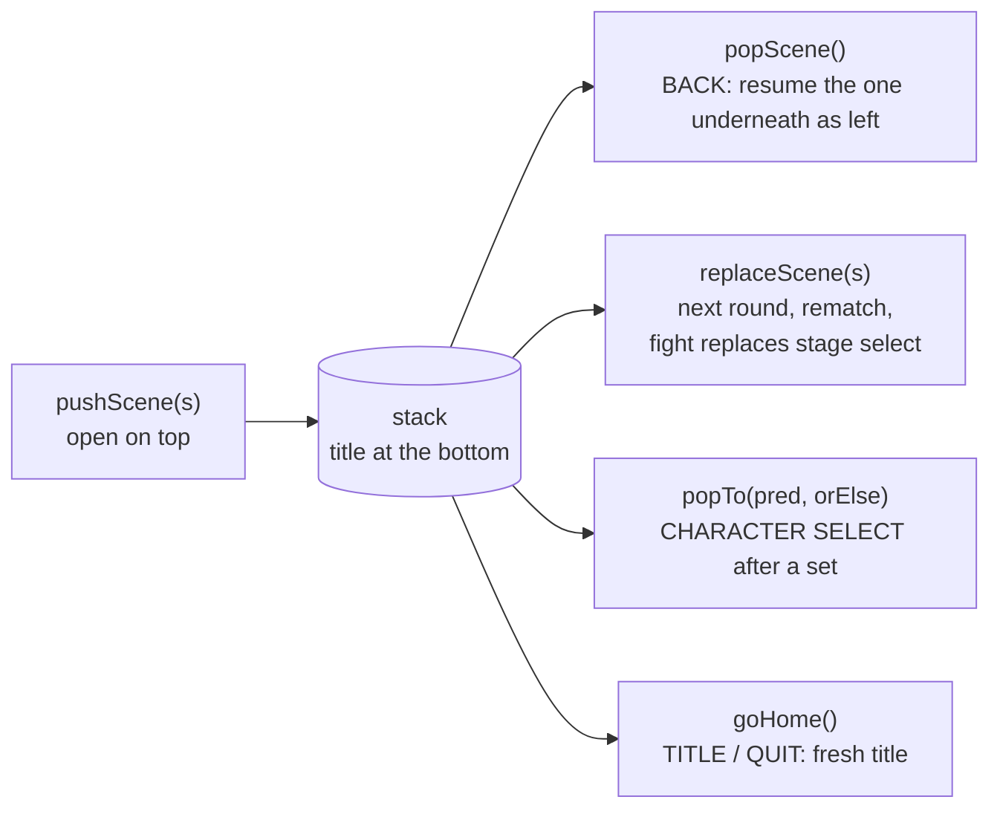

Scenes never import `TitleScene`; `main.ts` registers it with `setHome`. Screens with a `back` callback default it to `popScene`. `tests/scene-stack.ts` checks the rules.

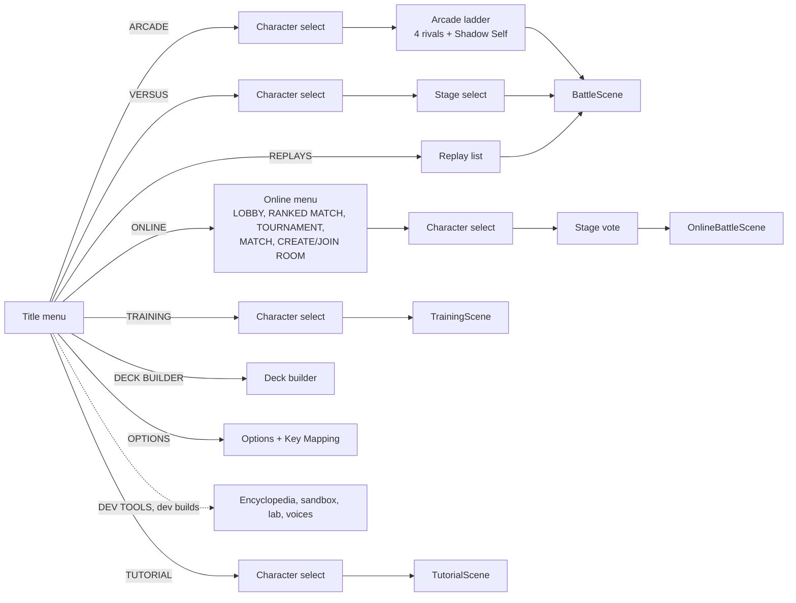

- `OnlineBattleScene` and `TrainingScene` extend `BattleScene`; `TutorialScene` drives one. Card previews run their own tiny muted Battle.
- Menus are mouse-first: scenes register click zones while drawing (`zone(...)`), the next update reads `hotZone()`. Combat is keyboard, gamepad or the touch pad (`engine/touch.ts`); see Input and platform.
- Everything kept between sessions goes through the save module (see Saves).

## CPU AI and styles

`Cpu.intent(b, f, dt)` (`game/ai.ts`) returns the same `Intent` a keyboard player would. When its think timer runs out it re-decides, in priority order: 1. dodge warned panels and shots, 2. cast the top spell when `card.ai()` agrees or it has waited long enough, 3. basic attacks (hold heavy when it will reach), 4. position (track the row, plus class habits).

| Level | Think | Aim | Dodge | Cast patience |
| --- | --- | --- | --- | --- |
| Easy | 0.6 s | 0.55 | 0 | 3 s |
| Normal | 0.22 s | 0.9 | 0.85 | 1.5 s |
| Hard | 0.12 s | 1 | 1 | 0.4 s |

Each class has 3 playstyles (aggro, conservative, defensive) in `game/playstyles.ts`, played at half strength. Difficulty sets both execution and which style shows up:

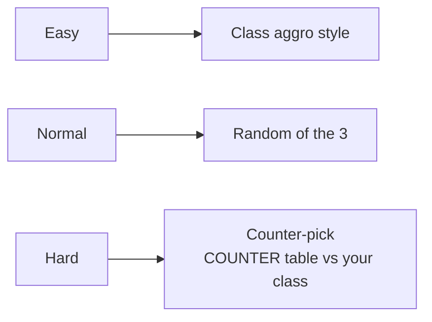

Hard also holds heavies (not Ranger or Rogue) and sidesteps out of the row when it can't hit back.

## Balance tooling

`dev/simulate.ts`: `runMatch` plays a real Battle with two `Cpu`s at 60 Hz (600 s cap = draw); `dev/instrument.ts` tags every hit with its spell. `runSeries` aggregates wins with a Wilson 95% range, time, turns, damage split and per-card stats.

| Tool | Run | Gives |
| --- | --- | --- |
| Sim CLI | `npm run sim -- 100 --cards` | All class pairs with starters, per-card table |
| Balance lab | dev build, `#lab` | The same in the browser: full grid on web workers, live `TUNING`, script box (`hp.mage = 700`, `card.power = 110%`) |
| Sandbox | `#sandbox` | Cast anything, dummies, can't-die, slow time, frame step, hit log |
| Encyclopedia | `#cards` | Every card face with filters |
| Grid CLI | `npm run balance -- --pools starter,archetype --n 40` | Full matchup grid on worker threads (~750 matches/s), `--set` / `--script` tweaks |
| Sweep | `npx tsx scripts/sweep.ts --out dir` | Every class pair at every CPU level over shipped decks, styles, starters and random decks |
| Tuner | `npx tsx scripts/tune.ts --out dir` | Searches small HP / attack / power tweaks that put every wheel matchup in the target band |

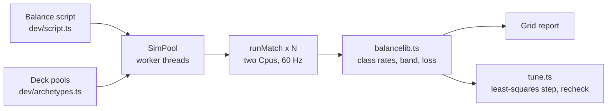

Reports live in project files under `balance/`.

## Input and platform

Keys, pads and the touch pad all become digital codes before any scene reads them, so the sim and `NetInput` only see on/off presses (lockstep and rollback stay deterministic). Full detail: [PLATFORM.md](PLATFORM.md).

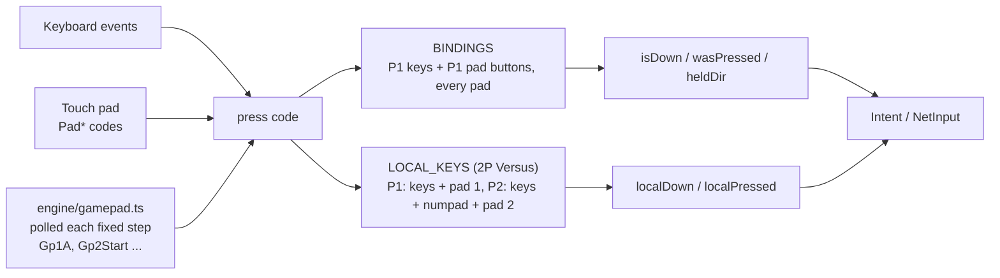

- Pads use the standard mapping; the left stick becomes the d-pad with hysteresis. Pad 1 is player 1 and pad 2 player 2 in local Versus. Key Mapping has a PAD column per player; bindings save as `pads`.
- `platform/index.ts` exports one `platform`: `storage` (the `PlatformStorage` the save module uses), `fullscreen` (Options FULLSCREEN row) and `lifecycle` (background: release input, suspend audio, `scene.suspend()`; QUIT on the title only when `canQuit`). A native shell overrides parts by setting `window.svsNative` before the game script runs.

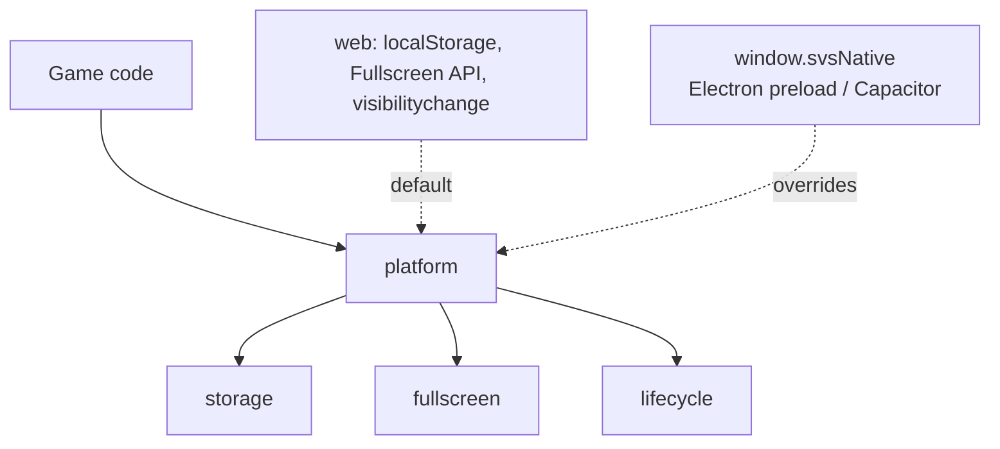

## Saves

One module, `engine/save.ts`, on top of the platform's file storage (`platform/storage.ts`). Nothing else touches `localStorage`. Full detail: [SAVES.md](SAVES.md).

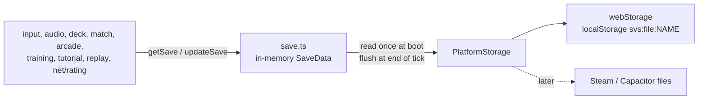

| File | Holds |
| --- | --- |
| `save.json` | keys, P2 keys, pads, audio, mute, decks, last match, training, tutorial done, arcade, rating, pending ranked result, lab script |
| `replays.json` | 20 recent + up to 20 starred replays, about 3 MB budget |

- Each file is `{game, v, data}`. Changing the shape means bumping `SAVE_VERSION` and adding `MIGRATIONS[n]`; never edit a shipped one.
- First load imports the 14 old `svs:*` keys and deletes them once the new file reads back. A corrupt file is kept as `save.json.bad`; a save from a newer build is read-only.
- Native builds `await initSave(storage)` before the game starts; the browser loads on first use.

## Build and publish

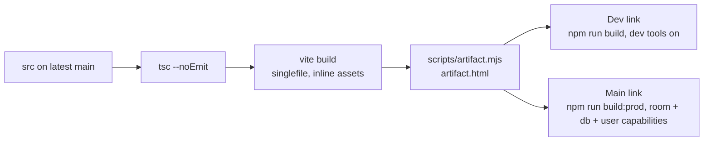

| Link | Build |
| --- | --- |
| Main (prod): https://claude.ai/artifact/1kBiHGD35b15oWBEWxcAcr | `npm run build:prod` → `dist-prod/artifact.html` |
| Dev: https://claude.ai/artifact/8xAkx41kQdJWmNQKZpBVJU | `npm run build` → `dist/artifact.html` |

Release: PR → Wes says "lgtm" → merge → rebuild from latest main → publish the main link and the dev link from the same commit. `DEV_TOOLS` (`src/flags.ts`) gates dev-only code; the dev menu is a dynamic import so prod ships none of it.

## Testing and CI

`.github/workflows/ci.yml` runs on every PR.

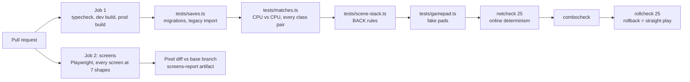

| Command | Where | Fails on |
| --- | --- | --- |
| `npm run typecheck` | CI | Type errors, unused locals |
| `npm run rollcheck` | CI | Rollback play ending differently from straight play |
| `npx tsx tests/saves.ts` | CI | Save migrations, legacy import, caps |
| `npx tsx tests/matches.ts` | CI | Crashes, stuck or broken full matches, a seed not replaying (unseeded CPU or rule rolls) |
| `npx tsx tests/scene-stack.ts` | CI | BACK not returning to the screen it came from |
| `npx tsx tests/gamepad.ts` | CI | Pad buttons, stick, 2P pad split or pad rebinding broken |
| `npm run netcheck` | CI | Two seeded battles with the same inputs drifting apart |
| `npm run combocheck` | CI | Combo counter counting escapable hits |
| `tests/screens/run.ts` | CI | Screens changing vs the base branch (report, not a hard fail) |
| `npm run replaycheck`, `npm run rankedcheck` | By hand | Replays not reproducing, ranked flow broken |
| `npm run fuzz`, `npm run fuzz:ui` | By hand | Random inputs crashing the sim or the menus |
| `npm run netsoak` | By hand | Desyncs or hangs over a fake bad network |
| `npm run perf` | By hand | Frame time regressions |
| `npm run sim` | By hand | Surprising win rates |

New screens go in `tests/screens/harness.ts`.
`window.__svs.getScene()` is exposed for automated playtests.

## In flight

- Modularize (#35): `src/content/registry.ts` and `src/content/stages/`, plus `npm run golden`; class folders follow.
- Sim events: `BattleEvent` sink feeding `engine/battleAudio.ts` (rollback thread).
- Touch UI (#51), BN indicators (#32), hit feel (#34), soundtrack, card pass on the outliers the balance sweep found.
