# Spell VS Steel architecture

How the game is put together, one section per system. Describes `main` at 20686e0 (2026-11-02).

The full version, with a drawn diagram per system, is the living doc: https://claude.ai/artifact/TSKxaHfJ3qJXaK4SC4az2V. Keep this file and that doc in step: when a PR changes the structure described here, update the matching section in the same PR.

- [Overview](#overview)
- [Assets](#assets)
- [Sim and game loop](#sim-and-game-loop)
- [Netcode](#netcode)
- [Characters and cards](#characters-and-cards)
- [Mods](#mods)
- [Stages](#stages)
- [Rendering and art pipeline](#rendering-and-art-pipeline)
- [Audio](#audio)
- [UI and screens](#ui-and-screens)
- [Expedition mode](#expedition-mode)
- [Input and platform](#input-and-platform)
- [CPU AI and styles](#cpu-ai-and-styles)
- [Balance tooling](#balance-tooling)
- [Build and publish](#build-and-publish)
- [Testing and CI](#testing-and-ci)
- [In flight](#in-flight)

## Overview

TypeScript + plain Canvas 2D, no engine, built by Vite into one self-contained HTML file. A single seeded `Battle` holds all the rules. Keyboard, CPU and online controllers all hand it the same `Intent` each frame; views, sound and observers only read it.

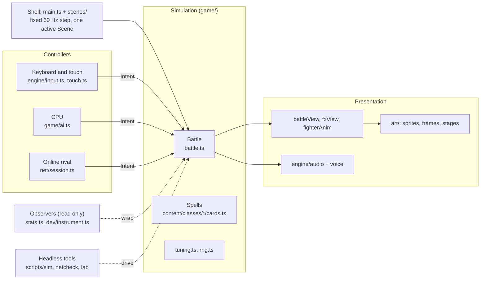

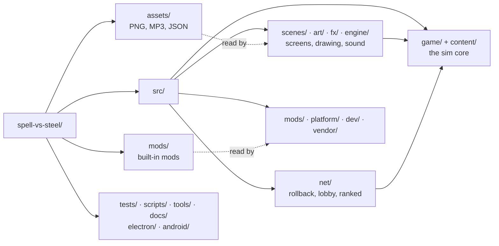

| Folder | What lives there |
| --- | --- |
| `src/content/` | Built-in content: each class's folder in `classes/<id>/` (spells, rules, tuning, decks, CPU, lessons), stages in `stages/`, `api.ts` (the only engine surface content imports) |
| `src/game/` | Rules (`battle.ts`, `cards.ts`, `ai.ts`, `tuning.ts`, `rng.ts`, decks, stats, Expedition and mobs) and the battle views |
| `src/scenes/` | Every screen: title, select, battle, online, training, tutorial, Expedition, deck builder, MODS, options |
| `src/fx/` | Spell and hit effects: baked-sheet players and pixelfx modules per class |
| `src/engine/` | Pixel gfx, bitmap font, input, gamepad, touch pad, audio, music, voice, save, the asset registry |
| `src/net/` | Rollback netplay, snapshots, session, packet protocol, transports, desync hash, lobby, ranked, tournaments |
| `src/art/` | Readers for the PNG sprites and palettes, card icons, logo (the art itself is in `assets/`) |
| `src/mods/` | Mod format, zip and PNG readers, install state |
| `src/dev/` | Dev tools, Art Lab, headless sims, live tuning (dev builds only) |
| `scripts/` | `sim`, `netcheck`, balance, music and voice generators, artifact packer |
| `tools/` | PixelLab builders for frames, effects and skin mods (Python) |

Platform decision (2026-10-26): stay on TypeScript; Steam through Electron, mobile through Capacitor; no consoles for now.

## Assets

Art and audio are real files under `assets/`, never written into the code (#127, #128, #129; #130 reads packed files in place). Tools and generators write the files, and the game reads them through one registry, `src/engine/assets.ts`. Detail in [ASSETS.md](ASSETS.md).

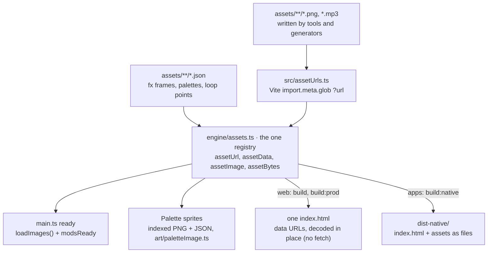

| Folder | Holds | Read by |
| --- | --- | --- |
| `assets/audio/music` | stage and menu tracks, loop points in `tracks.json` | `engine/musicTracks.ts`, `engine/audio.ts` |
| `assets/audio/voice` | announcer and class voice lines | `engine/voice.ts`, `engine/announcer.ts` |
| `assets/stages` | painted stage backdrops | `content/stages/index.ts` |
| `assets/fx` | baked effect sheets (PNG strip + JSON frames) per class and `impact` | `src/fx/sheet.ts` |
| `assets/fighters` | 48px PixelLab fighters, `-portrait` art, JSON palettes and frame lists | `art/pl/`, `art/paletteImage.ts` |
| `assets/monsters` | Expedition monster sprites | `art/mobSprites.ts` |
| `assets/cards` (+ `small/`) | 40px spell icons and their small versions | `art/cardIcons.ts` |
| `assets/sprites`, `assets/ui` | pets, emblems, the pixel font | `art/paletteImage.ts`, `engine/font.ts` |
| `mods/<id>/` | built-in mods (`mod.json` + PNGs) | `src/mods/boot.ts` |

- Images are decoded once at boot: `ready` in `main.ts` waits on `loadImages()` and `modsReady` before the first scene draws. Audio is read on first play through `assetBytes` (web: data URL decoded in place; apps: fetched file).
- Node (tests, balance tools) registers nothing, so art and audio quietly do nothing and the sim runs as before.
- To add an asset, drop the file under the right folder (or let its generator write it) and look it up by path. Never paste base64 into a `.ts` file.

## Sim and game loop

`src/main.ts` runs a fixed 60 Hz accumulator on `requestAnimationFrame`: for each whole 1/60 s step it calls `scene.update(1/60)` and clears input edges, then draws once (world layer 240×160 scaled 2×, sharp UI layer 480×320 on top) and commits this frame's click zones.

The scene owns the `Battle`. Local Versus asks each side's controller for an `Intent` and calls `b.update(dt, intents)`; online only steps when both sides' inputs for that frame are in.

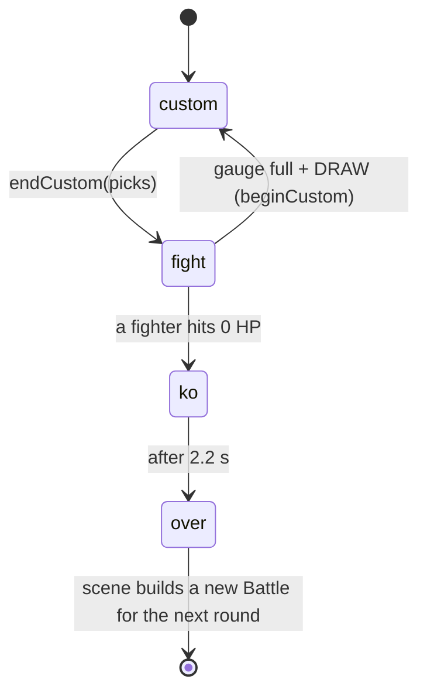

- `beginCustom()`: uncast picks go to the discard, class resources refill or grow, 5 spells drawn with a seeded reshuffle.
- Each fight step, in order: timers and anims, marks, warnings, panels, walls, fighters (with intents), projectiles, traps, pets, zones, then the KO check.

| Battle state | Holds |
| --- | --- |
| `f: [Fighter, Fighter]` | HP, position, resource, cooldowns, deck / queue / discard, statuses `st`, shields, DoTs, pose |
| `panels[6][3]` | Owner (grid steal), cracked / hole, burn, toxic, bless, curse, smoke |
| `walls`, `projectiles`, `traps`, `pets`, `warns` | Spawned objects; warnings flash panels 0.5 s before area hits |
| `timers`, `anims` | Closures from `later(delay, fn)` and `anim(dur, fn)` |
| `rand` | Seeded mulberry32; every rule roll goes through it |
| `fx`, `texts`, `shake`, `combo` | Display-only state for the views |

Determinism rules:

- Rule randomness comes from `b.rand()` or `shuffle(list, b.rand)`, never `Math.random`. `npm run netcheck` catches drift.
- Observers wrap methods on one instance and only read state.
- Each CPU rolls from `substream(b.seed, side)` (`game/rng.ts`), a stream separate from `b.rand`, so a CPU match replays exactly from its seed. Card `ai` hints get that `rand`. `tests/matches.ts` gives `Math.random` a new stream on every play, so a leak fails its replay check. Voice-line choice still uses `Math.random` (sound only).
- Double K.O.: if both fighters hit 0 HP on the same frame, the round is a draw (`winner` stays null, nobody scores, the set plays another round).
- Battle state is plain data. Anything that happens later (a timer, an animation, a projectile's hit, a telegraph's strike) is an effect record `{ fx, a }`: the id of an effect registered in `content/effects.ts` and its arguments. Spells register their later steps with `spellStep('<card>.<step>', (x, a, h) => ...)`, which rebuilds the cast's `CastCtx` from a plain `CastRef` when it runs. State the steps share (Blizzard's hit count) is an object in their arguments. `npm run rollcheck` fails on any function found in the battle's state. The one exception is `b.rand`, whose state is saved with `rand.setState`.
- Replays (`game/replay.ts`): a match is a list of round tapes (seed, decks, per-frame inputs) plus a rules fingerprint, so playback just reruns the Battle. `npm run replaycheck` checks a replay ends with the same hash.

## Netcode

Rollback (GGPO style, #44): both machines run the same seeded Battle and only trade controls. The rival's missing input is guessed; a wrong guess is fixed by rewinding to the last confirmed frame and replaying.

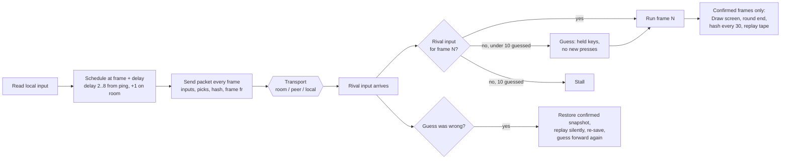

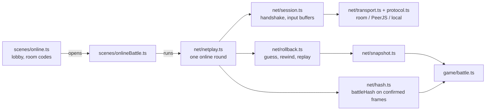

| File | Job |
| --- | --- |
| `net/netplay.ts` | `Netplay`: drives one online round for the scene and `netsoak`; input delay, pacing against the rival's frame `fr` (runs 2 frames when behind, skips a tick when ahead) |
| `net/rollback.ts` | `Rollback`: one confirmed snapshot, guesses up to `MAX_ROLLBACK = 10` frames, rewind and replay, `onConfirmed` feeds the replay `TapeWriter` |
| `net/snapshot.ts` | Snapshots the Battle object graph and restores it in place; watchers (post-match stats) pass extra roots |
| `net/session.ts` | `NetSession`: handshake, readiness, input buffers, RTT, status (waiting / connected / reconnecting / lost), desync flag |
| `net/protocol.ts` | `Packet`, `PROTOCOL = 8`, 10-bit input packing (2 chars per frame), room codes |
| `net/transport.ts` | `room` (claude.ai artifact presence), `peer` (WebRTC via PeerJS), `local` (BroadcastChannel, fake lag) |
| `net/hash.ts` | `battleHash(b)`, FNV-1a over everything the rules read |
| `scenes/online.ts`, `scenes/onlineBattle.ts` | Online menu and the Versus scene driven by `Netplay` |

- Every packet is the sender's whole current state, never a one-off event, so drops and merges lose nothing (this is what lets it ride on room presence, which keeps only the latest value).
- Draw picks travel in `packet.picks`; there is no pause online. Each round reseeds as `seed + r × 0x9e3779b9`.
- Bump `PROTOCOL` whenever rules or packets change.
- Silence: after 1.5 s the screen says RECONNECTING and holds; after 30 s the match counts as dropped. A backgrounded tab sends `away` and only pings, so the rival waits longer instead of timing out.
- `npm run netsoak` plays whole headless online matches over a fake bad network (lag, jitter, loss, duplicates, outages, latest-value-only delivery, hitches, background tabs) and compares every checksum.
- `npm run rollcheck` (in CI) proves rollback play ends exactly like straight play.

### Online services

Everything online rides on the artifact's `room` presence plus a small `db` for ratings; there is no game server.

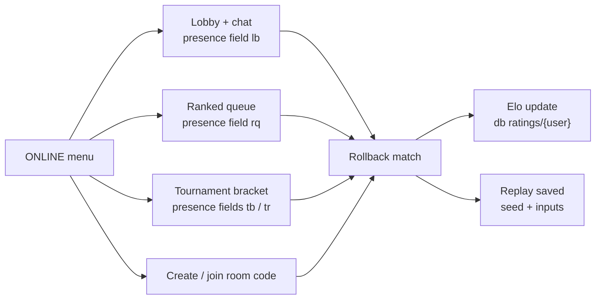

| File | Job |
| --- | --- |
| `scenes/lobby.ts` | Who's online, chat, challenges |
| `scenes/ranked.ts` | Queue, pairing, Elo in the artifact db (`ratings`), pending result recovery |
| `scenes/tournament.ts` | Bracket host and players over presence |
| `scenes/profile.ts` | Player profile: sets won/lost by class and mode (`game/profile.ts`, counted as each set ends), ranked rating, favorite fighter and spell deck, arcade bests; the way into the replays |
| `scenes/replays.ts` | Replay list and playback (pause, 1/4x to 4x, frame step: only how many recorded updates run per frame changes, so playback stays exact) |

- Both links must publish with the `room`, `db` (ratings rules) and `user` (profile) capabilities, or ranked breaks.
- `npm run rankedcheck` exercises the ranked flow by hand.

## Characters and cards

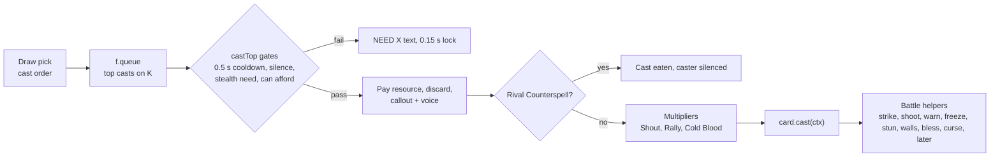

`CardDef` (`game/cards.ts`, which also gathers every class's spells into `ALL_CARDS` / `CARDS` in class order). Spells live in `content/classes/<id>/cards.ts` and import engine helpers only through `content/api.ts`. A spell's delayed steps are registered effects (`spellStep`), never closures. Fields: `id, name, cls, cost (0..5 | 'all'), rarity, element, damaging, lock, dmg, short, gain, needsStealth, cast(ctx), ai(b, f)`.

| Class | HP | Light / heavy | Resource | Comes back | Cards |
| --- | --- | --- | --- | --- | --- |
| Warrior | 9650 | 100 / 280 | Rage, max 5 | Heavy hits +1.5, taking damage 1 per 400 (max 1 per hit) | `content/classes/warrior/cards.ts` |
| Mage | 6900 | 60 / 280 | Mana | Max 1, +1 per Draw (cap 5), refills each Draw | `content/classes/mage/cards.ts` |
| Rogue | 6500 | 100 / 220 | Energy | Topped up to 5 each Draw | `content/classes/rogue/cards.ts` |
| Ranger | 7650 | 100 / 200 | Energy | Starts 2, +1 per Draw, grows standing still | `content/classes/ranger/cards.ts` |
| Priest | 6600 | 60 / 280 | Mana | Starts 3, +3 per Draw (cap 5) | `content/classes/priest/cards.ts` |

`tuning.ts` is the source of truth for numbers. Each class has 26 cards, a starter deck and 3 Mythic decks (`game/deck.ts`). Deck rules: exactly 30, 4 / 2 / 1 copies by rarity, max 5 Legendaries, exactly 1 Mythic. Players keep up to 10 named spell decks per class in `save.json` (`createCustom` / `renameCustom` / `cloneCustom` / `deleteCustom` in `deck.ts`); a match setup names one as `custom:<id>`. The deck builder opens on that list (edit, rename, clone, share, delete, or start a new one from a ready-made deck, an empty one or a share code; a new deck, an import and a clone are named before they are saved), and `scenes/nameEntry.ts` is the name box (typing, a phone's keyboard, or an on-screen QWERTY keyboard for gamepads). `game/deckCode.ts` makes and reads share codes, the only import / export (`SVS1-MAGE-<spells><check>-<NAME>`: spells grouped by copy count, 3 base-32 characters per spell from a 15-bit hash of its card id, so new cards never change old codes; `tests/deckCode.ts` fails if two spells of a class hash alike). Reading one only looks spells up in the class's own pool, then checks the deck rules (`deckRuleBroken`); an import becomes a new deck. `scenes/deckPanel.ts` is the DOM share / import panel (a gamepad's A copies the code, B closes).

Adding a class today touches: `content/classes/<id>/` (`cards.ts` listed in `game/cards.ts`, `tuning.ts` gathered by `game/tuning.ts` in roster order, `index.ts` registered in `content/classes/index.ts`), plus `art/sprites.ts` (+ generated sprites and frames), `game/fighterAnim.ts`, the HUD resource meter in `battleView.ts`, and voice lines. Spells, rules, tuning and HP, class info, decks, CPU and tutorial lessons live in the class folder (#87, #88, #90, #91); `game/classes.ts` reads `CLASS_IDS` / `PLAYABLE` / `CLASS_INFO` from the registry. `ClassId` is a plain string (any registered id, defined in `content/classes/registry.ts`), so nothing outside the registry lists the classes except art and animation tables, which still branch on the class.

A class folder's `index.ts` is its `ClassModule`: `{ id, info, rules, decks, cpu, lessons }`. `info` (`ClassInfo`) holds the name, resource and its colours, attack names, select-screen blurb and backdrop, and the `builds` / `melee` flags; the rest come from their own files. `decks.ts` holds the starter and one deck per Mythic (`game/deck.ts` reads them), `cpu.ts` the three playstyles, Hard's pick per matchup, how far the basics reach, where to stand and which spells to take from an offer (`game/ai.ts` asks `reach`, `taps`, `windup`, `stay`, `goal`, `pick`; shared building blocks `meleeGoal`, `rangedGoal`, `poolPick` live in `game/cpuKit.ts`), and `tutorial.ts` the class's tutorial lessons. The temperaments the styles start from live in `game/temperaments.ts`.

A class's `rules.ts` is a `ClassRules` object the engine asks about that class: `startRes` / `startResMax`, `pool(f)` (cap and current max for Draw-screen cost planning), `basic(b, f, kind)` (light and heavy attacks), and optional hooks `onDraw`, `tick`, `onHurt`, `gainRage`, `gainRes`. `battle.ts` has no `cls === '…'` branches; it calls `classRules(f.cls)`. Rules keep no state of their own (it lives on the Fighter), so rollback and replays see everything. `game/shots.ts` holds `panOf` and the `basicShot` effect so class modules never import `battle.ts` (which imports the class registry).

## Mods

A mod is a zip of a `mod.json` manifest and PNGs (format `spell-vs-steel-mod/3`, #129), shipped as a folder in `mods/` or imported by the player on the MODS screen (#124). Nothing in it runs as code or is put into HTML, and anything the format does not name is refused. Today a mod adds skins with their own drawn art for the 48px HD fighters, shown under a SKINS tab on fighter select (#125); format detail in [MODDING.md](MODDING.md).

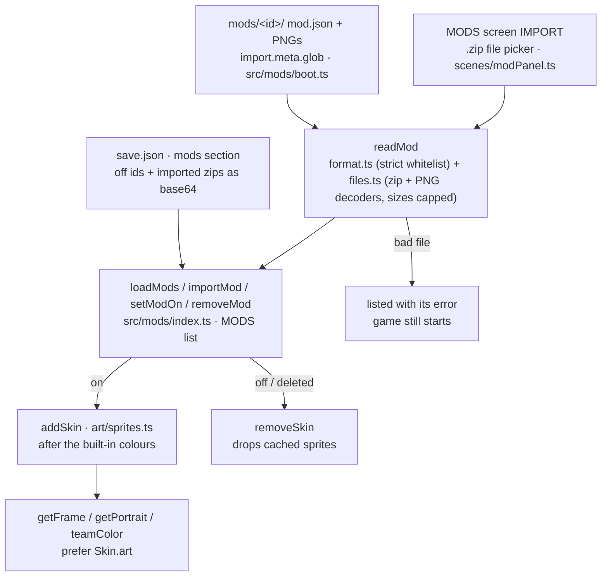

- Format `/3`: `id`, `name`, `author`, `skins`; each skin names a built-in `class`, a new `id`, a `sheet` PNG (the class's frames side by side at its HD size, order from `assets/fighters/<class>.json`, `idle0` required), an optional `portrait` PNG, a `team` colour and an optional `palette` (otherwise collected from the art). Pixels must be solid palette colours. A zip is at most 512 KB and may hold only `mod.json` and the PNGs it names. Older `/2` JSON mods (palette-letter rows) still load; `/1` (24px art), `__proto__` and unknown keys are refused.
- `format.ts` and `files.ts` are pure (no DOM, no game state); `tests/mods.ts` (in `npm test`) checks the fixtures, the shipped mods, hostile files, and installing (on/off, import, delete, reload from the save).
- Installed state lives in the save's `mods` section (`SavedMods`): ids switched off, and imported zips as base64 (at most 12, `IMPORT_BUDGET` about 1 MB). Built-in mods can be switched off, imported ones also deleted.
- `Skin.art: SkinArt` (`pal`, `team`, `ax`, `res`, `frames`, `portrait`) sits beside the palette recolours; the menu still sprite is `idle0` trimmed. Shipped: `mods/wes-skin/` (Mage: Wes) and `mods/hazel-druid-skin/` (Ranger: Hazel), written by `tools/pixellab/build_skin_mod.py` from PixelLab `transfer_outfit` frames of the class's own poses.
- Voice lines (#134): a skin's `voice` key maps a line (`cast`, `castBig`, `death`, `win`, `grunt`, `hurt`, `hurtBig`, `cast_<element>`) to 1 to 4 MP3s in the zip (each at most 64 KB, MP3 magic checked). `mods/index.ts` calls `setSkinVoice(cls, skin, bytes)` in `engine/voice.ts`, which decodes them into banks named `<cls>/<skin>:<line>`; a voiced skin speaks only its own clips. Battle `voice` events carry `skin` (sound only). `mods/boot.ts` globs MP3s too, and `scripts/voices/skin.py` puts a skin's ElevenLabs clips into its mod (voices in `lines.json` `skins`); the shipped Wes and Hazel mods have voices, grunts and hurt sounds.
- Cosmetic and render-only: the sim never sees mods. Online, an opponent without the mod sees your default colour.

## Stages

Stages are scenery only: same 6×3 grid, same red / blue rims, same rules.

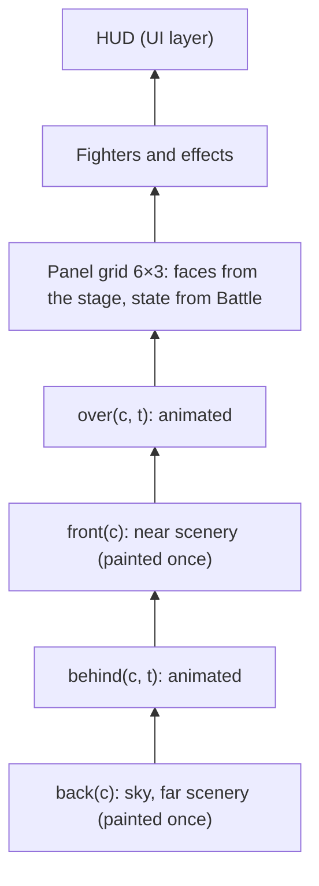

| Id | Name | File |
| --- | --- | --- |
| `colosseum` | Grand Colosseum | `content/stages/colosseum.ts` |
| `courtyard` | Castle Courtyard | `content/stages/courtyard.ts` |
| `archive` | Arcane Archive | `content/stages/archive.ts` |
| `frostpeak` | Frostpeak Pass | `content/stages/frostpeak.ts` |
| `emberforge` | Emberforge | `content/stages/emberforge.ts` |
| `elderwood` | Elderwood Ruins | `content/stages/elderwood.ts` |

Each stage is a module in `content/stages/`, registered in `content/stages/index.ts` (order = stage select and online vote order; new stages go at the end). `StageDef` (`content/stages/inked.ts`) = id, battle `music` (a track id from `engine/musicTracks.ts`), name, tag, `PanelLook`, panel `tex()`, up to four layer painters; `inkedStage(def)` wraps one as a `StageModule`. `getStage(id)` builds and caches; `stageMusic(id)` gives the battle theme (Colosseum theme if none); `STAGE_IDS` feeds stage select. `art/ink.ts` is the Inked toolkit. Online, both players vote; a tie wins, otherwise a seeded coin flip.

Painted backdrops (#110): every stage draws a PixelLab panorama behind its panels in place of the Inked scenery (panels, name and music stay). `content/stages/art/<id>.ts` holds each as a PNG data URL (a 792×672 master: the 792×336 panorama with plain sky above and a flat floor tone below from `tools/pixellab/extend_stage.py`, 2 image pixels per world pixel; `tools/pixellab/build_stages.py`). The masters are drawn simple and outlined to match the 48px fighters. `content/stages/index.ts` wraps each module with `painted(m)` → `withBackdrop(stage, {src, top, fill})` (`content/stages/backdrop.ts`); `top` puts the far wall's foot just above the top panel row, the outer 24-row bands repeat mirrored on taller or wider screens, `fill` shows while the image decodes, and headless runs skip it. `registerExtraStage` adds stages a mode uses for its own fights (Expedition's `crypt`): drawable by id, but outside stage select, random picks and online votes.

## Rendering and art pipeline

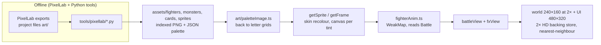

- HD layers and 48px fighters (#110): `HD = 2` (`engine/gfx.ts`). `main.ts` makes both offscreen canvases `HD` times larger and multiplies every `setTransform` by `HD`, so scenes still draw in world (240×160) and UI (480×320) coordinates and only art that asks for it uses the extra pixels. All five classes draw from `assets/fighters/<class>.png` + `.json` (48px PixelLab frames on a 64×64 canvas plus `-portrait` select art, written by `tools/pixellab/build_frames.py` and read through `src/art/pl/` and `art/paletteImage.ts`, #128); `getSprite` / `getFrame` give them `Sprite.res = 2` (`PL_RES`), and `drawFighterSprite` draws one sprite pixel as 1/res of a world pixel, so a fighter stands about 24 world pixels tall. Lookup order: a skin mod's `art`, then `PL`, then the older 24px sets (`res` 1). PixelLab skins hue-shift the main cloth colour family (`plPalette`); `letterIndex` reads a-z, A-Z and 0-9.
- Spell and hit effects: the sim only records `Battle.addFx(kind, …)`; `game/fxView.ts` asks `drawPfx` (`game/pfx.ts`, shots `drawShotPfx`) first, and `src/fx/index.ts` decides what each kind plays:

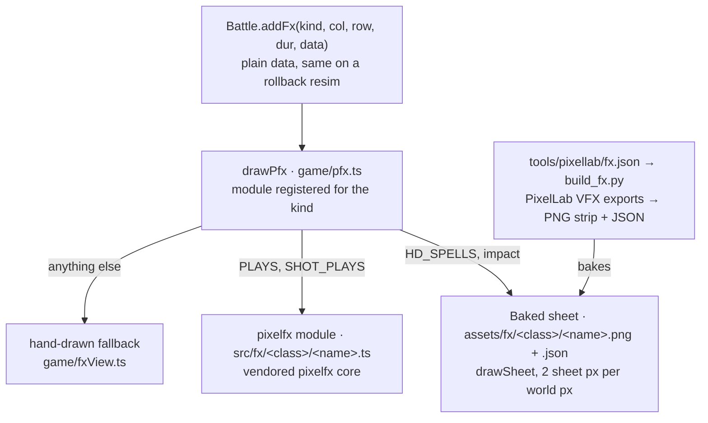

  - Baked sheets (#112 hit sparks and basics, #113 every class's spells): `fx.json` gives each export's origin (`ax`/`ay`) and optional `frames`, `fps`, `loop`, `panels`, `rows: 3` (column spells, drawn on every row via `meta.rows`), `hollow: k` (auras keep the fighter visible). `src/fx/sheet.ts`: `sheetFx` wraps a strip, `sheetFrame(age)` picks the frame, `drawSheet` draws it, `sheetsReady()` lets tools and tests wait for decoding.
  - `HD_SPELLS` maps many spell kinds onto one sheet per look. `impact` (`src/fx/hd/picks.ts`, a `pickFx`) picks the hit spark by element and tier, so shot hits register `none`.
  - pixelfx modules (#99-#104) remain for kinds with no sheet yet and for the Art Lab's BEFORE view; see [FX.md](FX.md). All three paths are render-only: the frame is a pure function of the fx's age.
- Fighters are never stretched in menus; spell effects keep a 24×24 footprint and take their element's colour.
- Visual state never goes into the Battle, so rollback and the hash never see it. Hit feel (#34, #73): the hit pause and slow-mo are rules (`Battle.hitStop` / `stopT` / `slowmo`, by hit tier from `TUNING.hitStop` and `TUNING.slowmo`; presses made during a pause are buffered and played after it), so they stay in lockstep and rollback. `game/hitFeel.ts` is the render-only part: a directional screen kick, a 1 px shudder while a pause runs, element impact sparks and popping damage numbers, deduped so a rollback doesn't replay them.
- Basic shots are real projectiles at a constant speed (`TUNING.<cls>.shotSpeed`, capped by `maxShotSpeed` 15; only Aimed Shot may pass it), so full-row heavies can be dodged. A shot lights its row in the shooter's team colour until it is gone.
- Team colours (#75, `game/teamColors.ts`, view-only): `team(side)` makes the watching player blue and the opponent red for panel rims and faces, telegraphs, reticles, shot paths and HUD ribbons. P1 is "you" in local 2P and CPU vs CPU.
- The canvas fits the window between 4:3 and 21:9 (shows more stage, no letterbox); phones in portrait give the bottom half to the touch pad.
- Screens with a full-height phone layout (`Scene.tall`: title, fighter select, spell deck select (#69), decks, stages, options, online, lobby, ranked, replays, tournament, arcade, training, tutorial, spell encyclopedia) take the whole portrait screen instead and draw big controls from `scenes/touchUi.ts`: the action bar, tabs, scrolling row lists, sheets and swipes.
- UI skin: Parchment (`scenes/skin.ts`). Cards: `scenes/cardView.ts`. Font: `engine/font.ts` (5×7).

## Audio

Effects are recorded samples (ElevenLabs, Storybook JRPG style) in `assets/audio/sfx/<slot>.mp3`. `assets/audio/sfx/sfx.json` maps each game sound name (and each spell effect as `fx:<kind>`) to the slots it plays; `engine/sfxSamples.ts` decodes them on first unlock and `sfx()` tries them first. Any name the map leaves out, or anything played before decoding finishes, falls back to the synthesized recipes in `sfxReal.ts`; DEV TOOLS > SOUND TEST can switch the whole game back to those. Music is an original sampled soundtrack (#40): `scripts/music/` renders a score DSL offline with a soundfont, and writes the MP3s plus `tracks.json` (loop points) to `assets/audio/music/`, which `engine/musicTracks.ts` reads. Voice clips (lines, attack grunts, hurt sounds, announcer) are ElevenLabs renders in `assets/audio/voice/<speaker>/<line>-<n>.mp3`; `scripts/voices/README.md` has the workflow (#127, #137). A mod skin can bring its own voice (#134): `setSkinVoice` adds `<cls>/<skin>:<line>` banks and `playVoice` takes the skin from the `voice` event (see Mods).

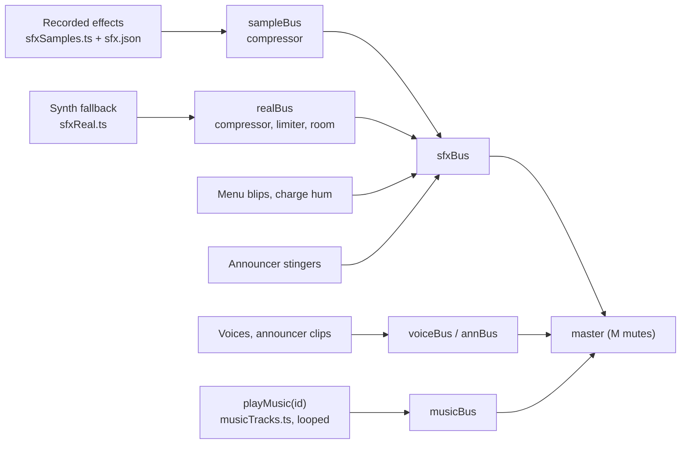

The Battle never calls audio (#55). It emits events through `b.sink`; `main.ts` sets `engine/battleAudio.ts` as the default sink, headless sims get none, and rollback switches it off while replaying corrections.

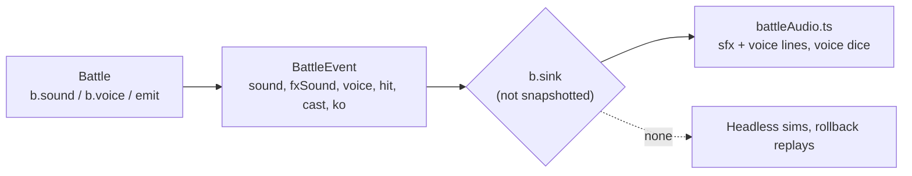

Each stage has its own theme; the menu and victory have theirs. Volume and mute live in `save.json`.

## UI and screens

Screens live on a stack (`scenes/stack.ts`, re-exported by `scenes/scene.ts`). A `Scene` has `update`, `draw(world, tick, ui)`, `enter?` (first open), `resume?` (shown again after the screen on top closes), `pad?` and `suspend?` (the game went to the background).

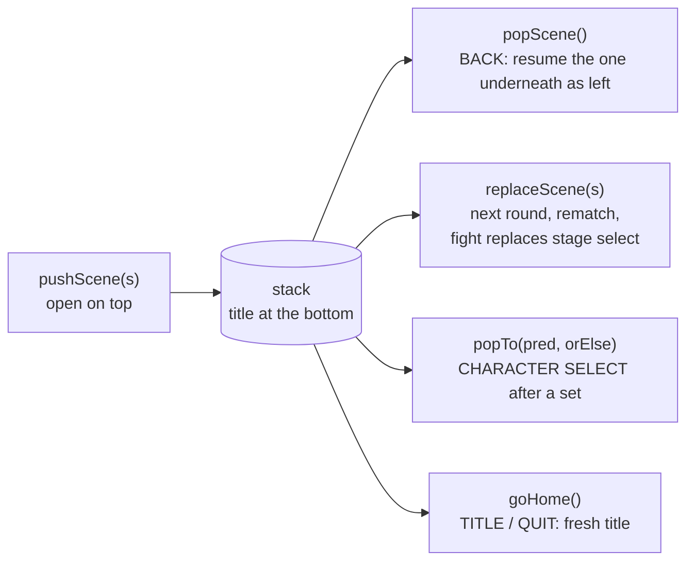

Scenes never import `TitleScene`; `main.ts` registers it with `setHome`. Screens with a `back` callback default it to `popScene`. `tests/scene-stack.ts` checks the rules.

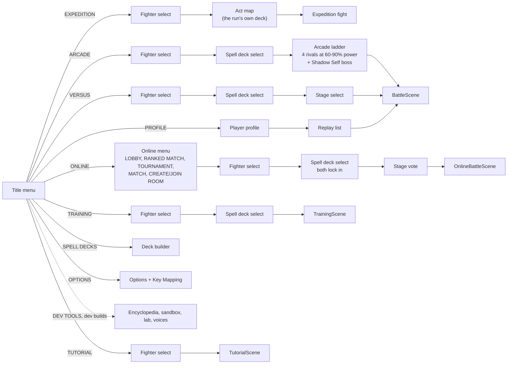

- Pre-match flow (#69): fighter, then spell deck (`scenes/deckSelect.ts`: both sides' decks side by side, EDIT, CPU level, match length), then stage; a step trail (1 FIGHTER / 2 SPELL DECK / 3 STAGE) runs across the three screens. Tapping a stage only selects it; FIGHT! starts.
- `OnlineBattleScene` and `TrainingScene` extend `BattleScene`; `TutorialScene` drives one. Card previews run their own tiny muted Battle.
- Menus are mouse-first: scenes register click zones while drawing (`zone(...)`), the next update reads `hotZone()`. Combat is keyboard, gamepad or the touch pad (`engine/touch.ts`); see Input and platform.
- Everything kept between sessions goes through the save module (see Saves).

### Phones (#51)

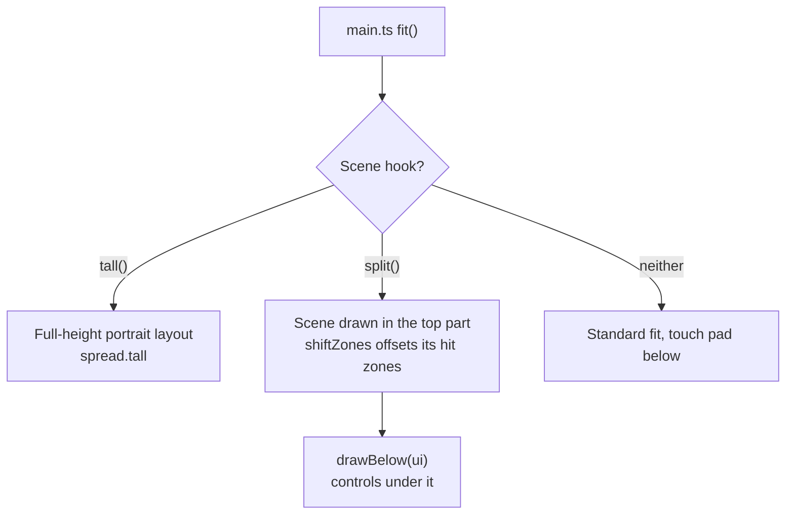

- Every menu has a `tall()` layout (#51, #63) except key mapping, the dev tools and the balance lab. Battle and tutorial use `split()`.
- `engine/input.ts` exports `gesture` (swipe, start, delta, held, fling); a swipe in from the left edge presses `PadBack`.
- `scenes/touchUi.ts` is the touch kit: `bigButton`, `actionBar`, `tabs`, `swipeIn` / `flickIn`, `dots`, `Scroller`, `rowList` (scrolling panel of big rows), `panel`, `sheet`, `tallArea` (safe-area insets from `touch.ts` `safeInsets()`).
- Touch settings (pad size S/M/L, left-handed, vibration) live in `engine/touch.ts` and save in the `touch` section of `save.json` (#63, old `svs:touch` imported once); `layout()` applies them.

## Expedition mode

The roguelike single-player mode (#107-#109), top of the title menu: three acts (the Forest, the Crypt, the Volcano), each a seeded branching map with a boss on top, a spell deck drafted as you go, gold and relics. A run lives in memory only.

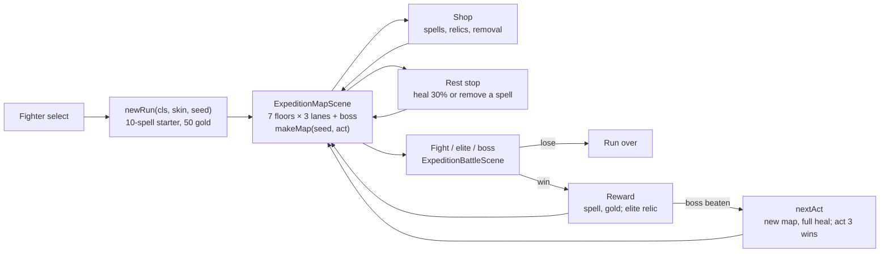

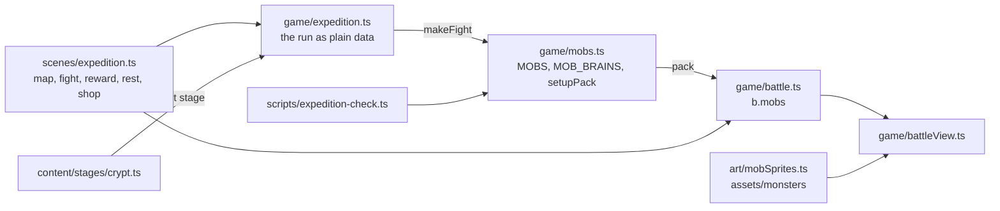

| File | Job |
| --- | --- |
| `game/expedition.ts` | The run as plain data (`ExpeditionRun`): `ACTS`, `makeMap`, `choices`, rewards, relics, shop stock, `makeFight` |
| `game/mobs.ts` | `MOBS` (HP, start column, rank, blurb) and each monster's brain in `MOB_BRAINS`; `setupPack` puts a pack on the field |
| `scenes/expedition.ts` | Map, fight, reward, rest, shop, deck and run-over screens, each with a phone portrait layout |
| `art/mobSprites.ts` | Monster sprites read from `assets/monsters` (PixelLab, 48px regulars / 56px elites / 80px bosses at 2 sprite px per world px), baked per tint like the fighters |
| `art/cardIcons.ts` | Spell icons: 40px PixelLab art from `assets/cards` and small versions from `assets/cards/small` for thumbnails |
| `content/stages/crypt.ts` | The Crypt stage (`registerExtraStage`) |
| `scripts/expedition-check.ts` | Balance check for packs and bosses |

- `makeFight` builds a normal `Battle` with the run's class, deck and HP; `setupPack` takes the right-hand fighter off the field and places up to three monsters (`b.mobs`, `b.f[1]` = the first). With mobs, `foes()`, `everyone()` and `retarget()` widen targeting and `packKo()` ends the fight when the pack is down.
- A monster is a `Fighter` with a plain-data `mob: MobState`; its brain (`MOB_BRAINS.get(kind).tick`, Battle Network virus style, every hit telegraphed) lives outside the state, and delayed hits are effect records (`mob.hit` etc.), so rollcheck rules still hold.
- In-battle relics (+10% damage, 400 shield, +2 resource) apply in `makeFight`. The map rolls from `seeded(seed + act)`, rewards and shops from `run.roll`, so a map plays the same whatever you buy.

## CPU AI and styles

`Cpu.intent(b, f, dt)` (`game/ai.ts`) returns the same `Intent` a keyboard player would. When its think timer runs out it re-decides, in priority order: 1. dodge warned panels and shots, 2. cast the top spell when `card.ai()` agrees or it has waited long enough, 3. basic attacks (hold heavy when it will reach), 4. position (track the row, plus class habits).

| Level | Think | Aim | Dodge | Cast patience |
| --- | --- | --- | --- | --- |
| Easy | 0.6 s | 0.55 | 0 | 3 s |
| Normal | 0.22 s | 0.9 | 0.85 | 1.5 s |
| Hard | 0.12 s | 1 | 1 | 0.4 s |

Each class has 3 playstyles (aggro, conservative, defensive) in `content/classes/<id>/cpu.ts`, played at half strength. Difficulty sets both execution and which style shows up:

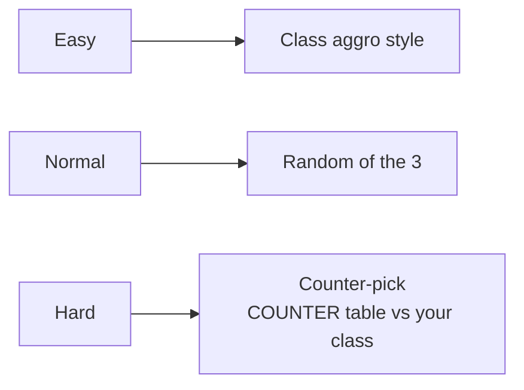

Hard also holds heavies (not Ranger or Rogue) and sidesteps out of the row when it can't hit back.

## Balance tooling

`dev/simulate.ts`: `runMatch` plays a real Battle with two `Cpu`s at 60 Hz (600 s cap = draw); `dev/instrument.ts` tags every hit with its spell. `runSeries` aggregates wins with a Wilson 95% range, time, turns, damage split and per-card stats.

| Tool | Run | Gives |
| --- | --- | --- |
| Sim CLI | `npm run sim -- 100 --cards` | All class pairs with starters, per-card table |
| Balance lab | dev build, `#lab` | The same in the browser: full grid on web workers, live `TUNING`, script box (`hp.mage = 7000`, `card.power = 110%`) |
| Art lab | dev build, `#art` | Per class: Spell FX (attacks and spells on loop from the real battle: shipped look, the look before the last pass, or drafts; fed by each class folder's `lab.ts`), Animations (every fighter move in any skin, zoomable), Sprites (frames, tints, portrait, spell icons; `src/scenes/artLabSprites.ts`) and Sounds (voice lines, and every sound a move fires, listed live). Stages tab: every registered stage idle, with all panel states, or under a CPU fight. Screens tab: opens any screen from `src/dev/screens.ts` with saves paused |
| Sandbox | `#sandbox` | Cast anything, dummies, can't-die, slow time, frame step, hit log |
| Encyclopedia | `#cards` | Every card face with filters |
| Grid CLI | `npm run balance -- --pools starter,archetype --n 40` | Full matchup grid on worker threads (~750 matches/s), `--set` / `--script` tweaks |
| Sweep | `npx tsx scripts/sweep.ts --out dir` | Every class pair at every CPU level over shipped decks, styles, starters and random decks |
| Tuner | `npx tsx scripts/tune.ts --out dir` | Searches small HP / attack / power / shot speed tweaks that put every wheel matchup in the target band |

```mermaid
flowchart LR
  script["Balance script<br/>dev/script.ts"] --> pool["SimPool<br/>worker threads"]
  decks["Deck pools<br/>dev/archetypes.ts"] --> pool
  pool --> runMatch["runMatch x N<br/>two Cpus, 60 Hz"] --> lib["balancelib.ts<br/>class rates, band, loss"]
  lib --> grid[Grid report]
  lib --> tune["tune.ts<br/>least-squares step, recheck"]
```

Reports live in project files under `balance/`.

## Input and platform

Keys, pads and the touch pad all become digital codes before any scene reads them, so the sim and `NetInput` only see on/off presses (lockstep and rollback stay deterministic). Full detail: [PLATFORM.md](PLATFORM.md).

```mermaid
flowchart LR
  KB[Keyboard events] --> P[press code]
  TP["Touch pad<br/>Pad* codes"] --> P
  GP["engine/gamepad.ts<br/>polled each fixed step<br/>Gp1A, Gp2Start ..."] --> P
  P --> B["BINDINGS<br/>P1 keys + P1 pad buttons, every pad"] --> A[isDown / wasPressed / heldDir]
  P --> L["LOCAL_KEYS (2P Versus)<br/>P1: keys + pad 1, P2: keys + numpad + pad 2"] --> LA[localDown / localPressed]
  A --> I[Intent / NetInput]
  LA --> I
```

- Pads use the standard mapping; the left stick becomes the d-pad with hysteresis. Pad 1 is player 1 and pad 2 player 2 in local Versus. Key Mapping has a PAD column per player; bindings save as `pads`.
- `platform/index.ts` exports one `platform`: `storage` (the `PlatformStorage` the save module uses), `fullscreen` (Options FULLSCREEN row) and `lifecycle` (background: release input, suspend audio, `scene.suspend()`; QUIT on the title only when `canQuit`). A native shell overrides parts by setting `window.svsNative` before the game script runs; the desktop app does this in `electron/preload.cjs` (QUIT, window fullscreen).

```mermaid
flowchart TB
  G[Game code] --> PF[platform]
  PF --> ST[storage] & FS[fullscreen] & LC[lifecycle]
  W["web: localStorage, Fullscreen API, visibilitychange"] -.default.-> PF
  N["window.svsNative<br/>Electron preload / Capacitor"] -.overrides.-> PF
```

## Saves

One module, `engine/save.ts`, on top of the platform's file storage (`platform/storage.ts`). Nothing else touches `localStorage`. Full detail: [SAVES.md](SAVES.md).

```mermaid
flowchart LR
  callers["input, audio, deck, match, arcade,<br/>training, tutorial, touch, replay, profile, net/rating"] -->|getSave / updateSave| S["save.ts<br/>in-memory SaveData"]
  S -->|read once at boot<br/>flush at end of tick| P[PlatformStorage]
  P --> web["webStorage<br/>localStorage svs:file:NAME"]
  P -.later.-> native[Steam / Capacitor files]
```

| File | Holds |
| --- | --- |
| `save.json` | keys, P2 keys, pads, audio, mute, spell decks (a list per class), last match, training, tutorial done, arcade, rating, pending ranked result, lab script, touch controls, profile (set results by class and mode, deck play counts) |
| `replays.json` | 20 recent + up to 20 starred replays, about 3 MB budget |

- Each file is `{game, v, data}`. Changing the shape means bumping `SAVE_VERSION` and adding `MIGRATIONS[n]`; never edit a shipped one.
- First load imports the 14 old `svs:*` keys and deletes them once the new file reads back. A corrupt file is kept as `save.json.bad`; a save from a newer build is read-only.
- Native builds `await initSave(storage)` before the game starts; the browser loads on first use.

## Build and publish

```mermaid
flowchart LR
  src[src on latest main] --> tsc[tsc --noEmit] --> vite["vite build<br/>singlefile, inline assets"] --> page["scripts/artifact.mjs<br/>artifact.html"]
  page --> dev["Dev link<br/>npm run build, dev tools on"]
  page --> prod["Main link<br/>npm run build:prod, room + db + user capabilities"]
  tsc --> native["vite build --mode native<br/>npm run build:native → dist-native/<br/>assets as real files, base ./"]
  native --> desk["Electron .exe + AppImage<br/>Capacitor Android APK"]
```

| Link | Build |
| --- | --- |
| Main (prod): https://claude.ai/artifact/1kBiHGD35b15oWBEWxcAcr | `npm run build:prod` → `dist-prod/artifact.html` |
| Dev: https://claude.ai/artifact/8xAkx41kQdJWmNQKZpBVJU | `npm run build` → `dist/artifact.html` |
| Desktop and Android apps | `npm run build:native` → `dist-native/`; `npm run desktop` to play, `dist:win` / `dist:linux` / `android:sync` to package; Actions > Play-test builds puts them in a GitHub Release. See [DESKTOP.md](DESKTOP.md) |

The web links stay one HTML file each: `vite-plugin-singlefile` packs every file under `assets/` in as a data URL, and `engine/assets.ts` decodes them in place rather than fetching, so a page that blocks `connect-src` still gets music, voices and the built-in mods (#130).

Release: PR → CI green → merge → publish the dev link from latest main. The main (prod) link is published only from the latest GitHub release tag. `DEV_TOOLS` (`src/flags.ts`) gates dev-only code; the dev menu is a dynamic import so prod ships none of it.

## Testing and CI

`.github/workflows/ci.yml` runs on every PR.

```mermaid
flowchart LR
  pr[Pull request] --> a["Job 1<br/>typecheck, dev build, prod build"]
  a --> sv["tests/saves.ts<br/>migrations, legacy import"] --> m["tests/matches.ts<br/>CPU vs CPU, every class pair"]
  m --> ss["tests/scene-stack.ts<br/>BACK rules"] --> gp["tests/gamepad.ts<br/>fake pads"] --> n["netcheck 25<br/>online determinism"]
  n --> c[combocheck] --> rc["rollcheck 25<br/>rollback = straight play"]
  pr --> b["Job 2: screens<br/>Playwright, every screen at 7 shapes"]
  b --> d["Pixel diff vs base branch<br/>screens-report artifact"]
```

| Command | Where | Fails on |
| --- | --- | --- |
| `npm run typecheck` | CI | Type errors, unused locals |
| `npm run rollcheck` | CI | Rollback play ending differently from straight play |
| `npx tsx tests/saves.ts` | CI | Save migrations, legacy import, caps |
| `npx tsx tests/matches.ts` | CI | Crashes, stuck or broken full matches, a seed not replaying (unseeded CPU or rule rolls) |
| `npx tsx tests/scene-stack.ts` | CI | BACK not returning to the screen it came from |
| `npx tsx tests/gamepad.ts` | CI | Pad buttons, stick, 2P pad split or pad rebinding broken |
| `npm run netcheck` | CI | Two seeded battles with the same inputs drifting apart |
| `npm run combocheck` | CI | Combo counter counting escapable hits |
| `tests/screens/run.ts` | CI | Screens changing vs the base branch (report, not a hard fail) |
| `npm run replaycheck`, `npm run rankedcheck` | By hand | Replays not reproducing, ranked flow broken |
| `npm run fuzz`, `npm run fuzz:ui` | By hand | Random inputs crashing the sim or the menus |
| `npm run netsoak` | By hand | Desyncs or hangs over a fake bad network |
| `npm run perf` | By hand | Frame time regressions |
| `npm run golden` | By hand (refactor PRs) | Any behaviour change: 100 seeded CPU matches plus the card, class, deck and `TUNING` tables vs `scripts/golden.txt`; gameplay PRs run `golden:write` |
| `npm run sim` | By hand | Surprising win rates |

New screens go in `src/dev/screens.ts` (shared by the screen tests and the Art Lab).
`window.__svs.getScene()` is exposed for automated playtests.

## In flight

- Modularize: stages are modules (#35); spells (#62), rules (#87), decks, CPU and lessons (#88), tuning and class info (#90, #91) sit in `src/content/classes/<id>/`; next art, animation and voices.
- Mods: a MODS screen to load a user's mod file at runtime through the same `parseMod`; spells, stages and classes as mod content once they are pure data.
- Expedition: saving a run mid-way; Expedition in the profile.
- BN indicators (#32).
