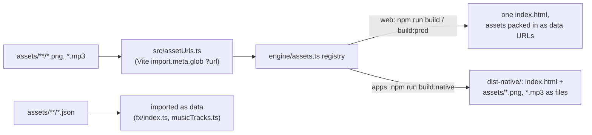

# Game assets

Art and audio are real files under `assets/`, never written into the code. Tools and generators write them;
the game reads them through one registry, `src/engine/assets.ts`.

```
assets/
  audio/music/<track>.mp3       the soundtrack (scripts/music/gen.mjs)
  audio/music/tracks.json       loop points per track, in seconds
  audio/voice/<speaker>/<line>-<n>.mp3   voice lines (scripts/voices/gen.py); "ann" is the announcer
  stages/<stage>.png            painted stage backdrops (tools/pixellab/build_stages.py)
  fx/<class>/<effect>.png       effect frames as one horizontal strip (tools/pixellab/build_fx.py)
  fx/<class>/<effect>.json      frame size and count, speed, origin, and how the game shows the effect
```

## How a build ships them



- **Web links** (the claude.ai artifacts) must be a single self-contained page, so `vite-plugin-singlefile`
  packs every asset into it as a data URL at build time. Only the build output holds them that way.
- **Desktop and Android** (`build:native`, used by `npm run desktop`, `dist:*`, `android:sync` and the
  Play-test builds workflow) keep them as real files beside `index.html`, loaded by relative path.

## Loading

- `main.ts` waits for `loadImages()` before the first screen, so every PNG is decoded and drawing code reads
  them synchronously: `assetImage('stages/crypt.png')`.
- Audio is fetched and decoded the first time it plays: `assetBytes('audio/music/menu.mp3')`.
- In Node (sims, tests) nothing is registered: lookups come back empty and nothing draws, so the headless
  game never depends on art.

## Adding an asset

Drop the file in the right folder; `src/assetUrls.ts` picks up every `.png` and `.mp3` under `assets/` on the
next build. A new effect sheet needs both its `.png` and `.json`; it registers as effect `hd/<class>/<name>`.
