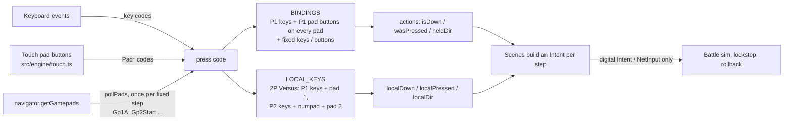
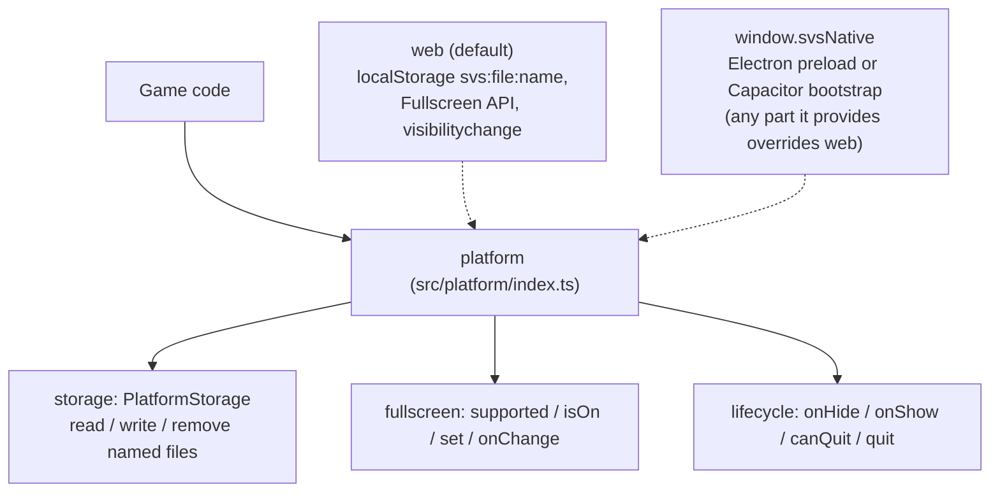

# Input and platform layer

How keys, gamepads and touch reach the game, and the one seam native builds (Steam via Electron, mobile via
Capacitor) swap out. Part of the architecture docs; see `docs/ARCHITECTURE.md` once it lands.

## Input

- `src/engine/gamepad.ts` reads pads with the standard mapping. Each pad takes the first free slot (max two)
  when it connects and keeps it until it disconnects, so **pad 1 is player 1 and pad 2 is player 2** in local
  Versus. Outside two-player Versus every pad drives player 1.
- The left stick becomes the d-pad buttons with hysteresis (on past 0.5, off under 0.35); analog triggers are
  pressed past 0.5. The sim never sees an analog value.
- Pads are polled at the start of every fixed 1/60 s step in `src/main.ts`, so pad presses land on step
  boundaries exactly like keys. Intents and `NetInput` stay digital, so lockstep and rollback stay deterministic.
- A pad that disconnects releases every button it held. Losing focus or going to the background releases
  everything (`releaseAll`).

### Default pad buttons

| Action | Button | Fixed extras (always on, any pad) |
| --- | --- | --- |
| Move | D-pad | left stick moves; d-pad always moves |
| Attack / OK | A | A always confirms |
| Cast / Back | B | B and SELECT always back out |
| Open Draw screen | RB | LB / RB switch tabs in menus |
| Pause | START | START always pauses |
| | | Y resets positions in Training |

Rebinding lives on Options > Key Mapping: pick a row and press either a key or a pad button, and that
device's column changes. SELECT cancels; SELECT and HOME can't be bound, START only to pause. Player 1 and
player 2 have separate pad bindings. Pad bindings save as `svs:pads` (moving into the save module, PR #48).
Hints (`k()`, `localKey()`) name pad buttons once the last press was on a pad.

Tested by `tests/gamepad.ts` (fake pads, runs in CI) and the `key-mapping-pad` screen shot.

## Platform layer

- `platform` is picked once at load: the web implementation, with any parts a native shell put on
  `window.svsNative` before the game script runs laid over it.
- **Storage** is the file-like `PlatformStorage` shared with the save module (`src/platform/storage.ts`,
  `src/engine/save.ts`). Backends without `readSync` must `await initSave(platform.storage)` before the game
  modules import.
- **Fullscreen**: Options shows a FULLSCREEN row only where `supported()` (not iPhone Safari).
- **Lifecycle**: going to the background releases input, suspends audio and calls the scene's `suspend()`:
  single-player fights and the tutorial open the pause menu; online matches keep running. The title shows QUIT
  only when `canQuit` (the desktop app).

### What a native build provides

| Part | Electron (Steam) | Capacitor (mobile) |
| --- | --- | --- |
| `storage` | files in the app data folder (Steam Cloud syncs them) | Filesystem plugin |
| `fullscreen` | `BrowserWindow.setFullScreen` over IPC | usually omitted (always full screen) |
| `lifecycle` | window minimise / restore; `quit` = `app.quit()`, `canQuit: true` | App plugin `pause` / `resume` |
