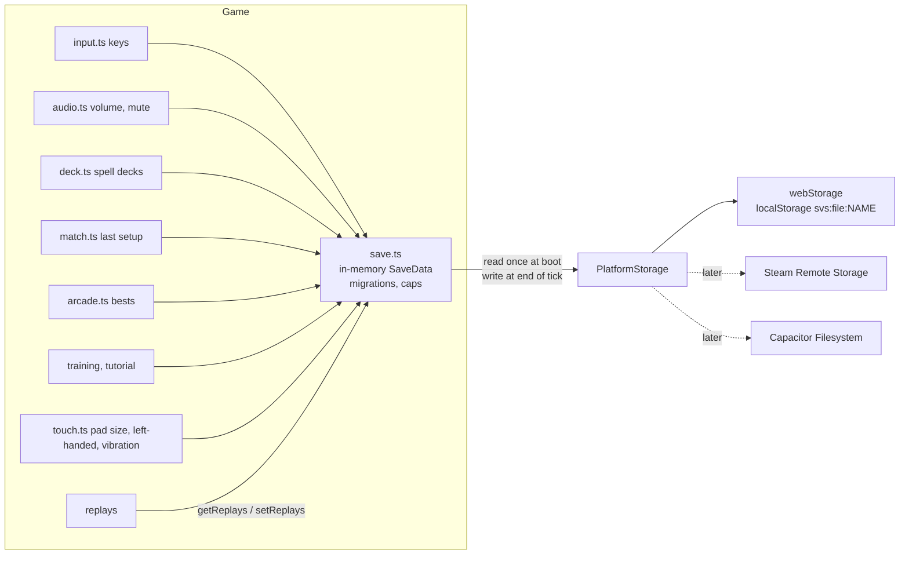
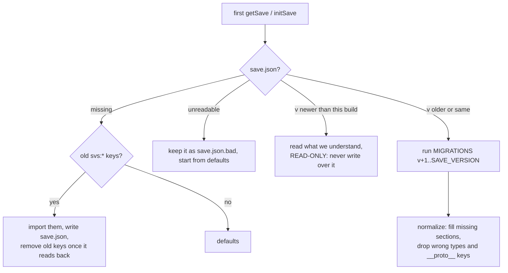

# Saves

Everything the game keeps between sessions goes through one module, `src/engine/save.ts`, which sits on the
platform's file storage (`src/platform/storage.ts`). Nothing else touches `localStorage`.

## Files

| File | Holds | Written |
| --- | --- | --- |
| `save.json` | key bindings (P1, P2, pads), audio + mute, your spell decks (up to 10 per class, each with an id and a name), last match setup, training settings, tutorial done, arcade bests, ranked rating + pending match, lab script, touch controls | on every change |
| `replays.json` | saved replays, newest first | when replays change |

Each file is `{ "game": "spell-vs-steel", "v": <SAVE_VERSION>, "data": ... }`.

## Load path

## Rules

- Change the shape: bump `SAVE_VERSION` and add `MIGRATIONS[n]` that turns version n-1 into n. Never edit a shipped migration. `npx tsx tests/saves.ts` must pass.
- Reads are synchronous from memory. The browser loads on first use; native builds `await initSave(platform.storage)` before the game starts.
- Replays: 20 most recent + up to 20 starred, and the oldest unstarred go first if the file passes ~3 MB. Enforced in `setReplays`.
- Old keys imported once: `svs:keys`, `svs:p2keys`, `svs:pads`, `svs:audio`, `svs:muted`, `svs:deck:<class>`, `svs:match`, `svs:training`, `svs:tutorial`, `svs:arcade`, `svs:replays`, `svs:rating`, `svs:ranked-pending`, `svs:lab:script`, `svs:touch`.
- `svs:touch` (touch controls) was its own key for a short while after `save.json` existed, so it is also taken in when a save has no `touch` section yet, then removed.
- Versions so far: 1 is the first save.json; 2 (#78) turned the one custom deck per class into a list of named decks (`{ id, name, cards }`) and moved a match setup's `'custom'` deck to `'custom:<id>'`.
- A new section that defaults to empty (like `touch`) needs no version bump: older saves just get the default, and older builds ignore it.
